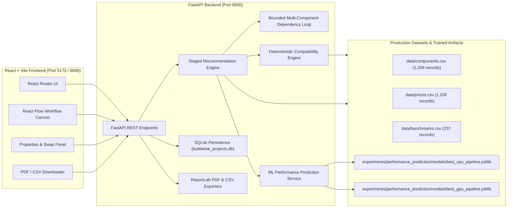

# BuildWise-AI — Intelligent PC Component Recommendation & Upgrade Platform

**BuildWise-AI** is a modern, full-stack, AI-powered PC component recommendation and upgrade intelligence system tailored for the Indian hardware market with verified INR pricing.

Designed for college project reviews, academic demonstrations, and real-world PC building, BuildWise-AI features:
- **Interactive Visual Canvas:** Left-to-right horizontal React Flow hardware architecture canvas.
- **Dependency-Aware Upgrade Mode:** Detects multi-component hardware bottlenecks (e.g., GPU upgrades requiring higher-wattage PSU replacements; CPU upgrades requiring new socket Motherboards and DDR5 RAM) and retains reusable parts at ₹0.
- **Supervised ML Performance Prediction:** Serialized scikit-learn Ridge Regression models predicting Cinebench R23 Multi-Core scores (CPU) and 3DMark Time Spy Graphics scores (GPU).
- **Curated Production Datasets:** 1,208 components, 1,109 Indian retail price observations, and 237 empirical benchmark observations.
- **Publication-Ready Exports:** One-click downloadable PDF and CSV reports with component roles, specs, prices, and compatibility justifications.
- **Dual Interface:** Modern React frontend (powered by FastAPI) and legacy Streamlit analytical application.

---

## 1. System Architecture



---

## 2. Requirements & Prerequisites

To run BuildWise-AI on another Windows laptop, ensure the following software is installed:

1. **Operating System:** Windows 10 or Windows 11 (64-bit).
2. **Python:** Python 3.10, 3.11, or 3.12 ([Download Python](https://www.python.org/downloads/)).
   > *During Python installation, ensure you check **"Add Python to PATH"**.*
3. **Node.js & npm:** Node.js v18, v20, or v22 LTS ([Download Node.js](https://nodejs.org/)).
4. **Git:** Git for Windows ([Download Git](https://git-scm.com/)).

---

## 3. Fresh Windows Installation & Setup Guide

Open **Command Prompt (`cmd`)** or **PowerShell** and follow these steps:

### Step 1: Clone the Repository
```bat
git clone https://github.com/1nishanth-s/buildwise.git
cd buildwise
```

### Step 2: Set Up Python Virtual Environment
```bat
python -m venv .venv
```

Activate the virtual environment:
- In **Command Prompt (`cmd`)**:
  ```bat
  .venv\Scripts\activate.bat
  ```
- In **PowerShell**:
  ```powershell
  .venv\Scripts\Activate.ps1
  ```
  *(If PowerShell displays an execution policy error, run `Set-ExecutionPolicy -Scope Process -ExecutionPolicy Bypass` first).*

Upgrade `pip` and install all required Python dependencies:
```bat
python -m pip install --upgrade pip
pip install -r requirements.txt
```

### Step 3: Set Up the React Frontend
Open a new terminal window, navigate to the `frontend/` directory, and install npm packages:
```bat
cd frontend
npm install
```

Build the production frontend bundle:
```bat
npm run build
```

---

## 4. Running the Application

### Option A: Modern Full-Stack Platform (FastAPI + React Canvas) — Recommended

BuildWise-AI's FastAPI backend serves the compiled React application directly:

1. In the repository root with virtual environment activated:
   ```bat
   python -m uvicorn src.api.main:app --host 127.0.0.1 --port 8000 --reload
   ```
2. Open your web browser and navigate to:
   ```
   http://127.0.0.1:8000/
   ```

*(Optional for Frontend Developers: to run Vite live development server, in `frontend/` run `npm run dev` and open `http://localhost:5173/`).*

### Option B: Streamlit Analytical Dashboard

To run the standalone analytical Streamlit dashboard:
```bat
streamlit run app.py
```
Open `http://localhost:8501/` in your browser.

---

## 5. Machine Learning Models & Datasets

### Serialized Models
BuildWise-AI uses two pre-trained scikit-learn Ridge Regression pipelines serialized with `joblib`:
- **CPU Multi-Core Pipeline:** `experiments/performance_prediction/models/best_cpu_pipeline.joblib`  
  *Algorithm:* Ridge Regression ($\alpha=10.0$)  
  *Target:* Cinebench R23 Multi-Core benchmark points.
- **GPU Graphics Pipeline:** `experiments/performance_prediction/models/best_gpu_pipeline.joblib`  
  *Algorithm:* Ridge Regression ($\alpha=1.0$)  
  *Target:* 3DMark Time Spy Graphics benchmark score.

### Production Datasets
- `data/components.csv`: 1,208 hardware components across 8 categories (CPU, GPU, Motherboard, RAM, PSU, Cooler, Case, Storage).
- `data/prices.csv`: 1,109 verified Indian retailer price observations (Computech, MD Computers, Vedant, Prime ABGB, PC Studio, etc.).
- `data/benchmarks.csv`: 237 empirical Cinebench and 3DMark benchmark test scores.

---

## 6. Running Tests

### Backend Unit Tests (189 tests)
Runs the complete test suite including dataset validator, compatibility engine, staged recommender, ML integration, SQLite persistence, PDF/CSV exporters, and multi-component upgrade tests:
```bat
python -m unittest discover -s tests -v
```

### Frontend Tests (Vitest — 14 tests)
```bat
cd frontend
npm run test
```

### End-to-End Browser Tests (Playwright — 10 tests)
Verifies the complete browser journey across Build Mode, Upgrade Mode, component replacement, budget tracker, and export downloads:
```bat
cd frontend
npx playwright test
```

---

## 7. Key Project Modules

- `src/api/main.py`: FastAPI application, CORS middleware, REST endpoints, and static file serving.
- `src/recommender/staged_recommender.py`: Staged recommendation engine, bounded multi-component dependency loop, and React Flow graph construction.
- `src/compatibility.py`: Deterministic compatibility evaluation rules (socket, memory generation, clearance, power).
- `src/performance_service.py`: Wrapper for supervised CPU and GPU ML predictions.
- `src/storage/db.py`: Local SQLite persistence (`buildwise_projects.db`) with automatic table initialization.
- `src/export/`: ReportLab PDF exporter and Excel-compatible CSV exporter.
- `frontend/src/pages/WorkflowCanvas.tsx`: Interactive horizontal workflow canvas with live budget tracker and properties panel.
- `frontend/src/components/nodes/WorkflowNode.tsx`: Custom React Flow nodes displaying component status, upgrade roles, and specs.

---

## 8. License & Provenance

BuildWise-AI builds upon public hardware specifications and open benchmark datasets. Retailer price observations represent dated snapshots from Indian retailers to ensure reproducible and deterministic recommendations without live scraping dependencies.
