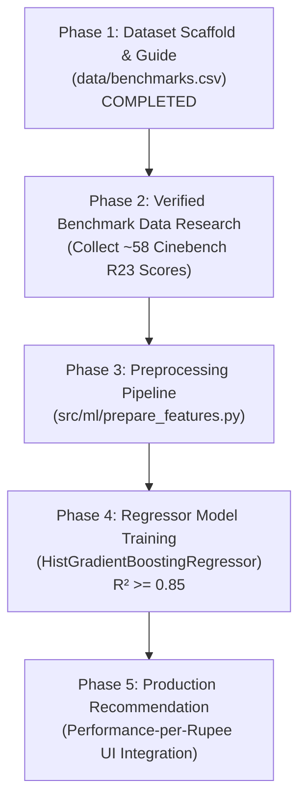

# BuildWise-AI — CPU Benchmark Dataset Collection & Verification Guide

**Version:** 1.0  
**Target File:** [`data/benchmarks.csv`](file:///E:/BuildWise-AI/BuildWise-AI1/data/benchmarks.csv)  
**Primary Suite:** Cinebench R23  
**Primary Metric:** Multi-Core Score (points / `pts`)  
**Target Hardware:** 64 Catalog Processors (AMD AM4/AM5, Intel LGA1700/LGA1851)  

---

## 1. Why Cinebench R23 Multi-Core?

To replace subjective badges with a genuine machine learning model, BuildWise-AI uses **Cinebench R23 Multi-Core** as its initial target regression variable:

1. **Deterministic & Objective:** Cinebench R23 renders a photorealistic 3D scene using Cinema 4D's render engine. It taxes all physical and virtual threads at 100% sustained utilization.
2. **Architecture & IPC Sensitive:** Unlike synthetic clock-speed multipliers, Cinebench directly reflects real Instructions Per Clock (IPC) improvements across CPU architectures (e.g., Zen 3 vs Zen 4 vs Zen 5, or Intel Alder Lake vs Raptor Lake vs Arrow Lake).
3. **Transparent & Accessible:** Hundreds of verified lab reviews exist from reputable global testing outlets with standardized test equipment.
4. **Direct Utility for PC Builders:** A high multi-core score correlates directly with faster code compilation, 3D rendering, video export times, and heavy multitasking performance.

---

## 2. Dataset Schema (`data/benchmarks.csv`)

The benchmark dataset stores empirical measurements in a dedicated CSV file:

```csv
benchmark_id,component_id,category,benchmark_suite,benchmark_metric,score,score_unit,source_name,source_url,verified_date,test_configuration
```

| Field Name | Type | Constraint | Example | Description |
|---|---|---|---|---|
| `benchmark_id` | String | Unique, non-blank | `BM_CPU_001` | Sequential unique identifier for the benchmark observation. |
| `component_id` | String | Must exist in `data/components.csv` | `cpu-r5-9600x` | Exact catalog identifier of the processor. |
| `category` | String | Must be `cpu` | `cpu` | Component category. |
| `benchmark_suite` | String | Non-blank | `Cinebench R23` | Benchmark software suite used. |
| `benchmark_metric` | String | Non-blank | `Multi-Core Score` | The exact test executed within the suite. |
| `score` | Integer / Float | Finite number > 0 | `16850` | Genuine measured benchmark score. |
| `score_unit` | String | Non-blank | `pts` | Measurement unit (`pts` for Cinebench R23). |
| `source_name` | String | Non-blank | `TechPowerUp` | Name of the testing publication or verified database. |
| `source_url` | String | Valid `http://` or `https://` | `https://www.techpowerup.com/review/...` | Direct web link to the review or benchmark page. |
| `verified_date` | String | ISO format (`YYYY-MM-DD`) | `2026-11-02` | Date the benchmark score and source were audited. |
| `test_configuration` | String | Non-blank description | `Stock limits, DDR5-6000, 360mm AIO` | Hardware test environment (cooler, RAM, power limits). |

---

## 3. Benchmark Verification & Integrity Rules

> [!IMPORTANT]
> **Zero Tolerance for Synthetic or Placeholder Scores:**
> - Never insert estimated, guessed, extrapolated, or placeholder benchmark scores into `data/benchmarks.csv`.
> - Never copy `performance_tier` strings into the score column.
> - Never use component prices as performance indicators.
> - Only recorded, publicly verifiable empirical lab measurements are accepted.

### Verification Checklist for Researchers
1. **Stock Clocks & Default Power Limits:** The benchmark score must be obtained at manufacturer stock clocks. Exclude results tested with extreme sub-ambient cooling (liquid nitrogen / LN2), aggressive manual overclocks, or modified power limit overrides (unless standard motherboard default PL1/PL2 behavior is noted in `test_configuration`).
2. **Approved Independent Review Outlets:**
   - **Tier A Tech Publications:** TechPowerUp, AnandTech, Tom's Hardware, Gamers Nexus, Hardware Unboxed, KitGuru, ComputerBase, Puget Systems.
   - **Verified Aggregation Databases:** CPU-Monkey (standard Cinebench R23 database), NotebookCheck (Desktop CPU benchmark repository).
3. **Exact Component Identity Match:** Ensure the benchmarked CPU matches the exact catalog SKU. Do not confuse `KF` variants with `K` variants if power limits or clocks differ, and do not confuse mobile APUs with desktop socketed chips.
4. **Duplicate Observation Rule:** Each CPU should have **one authoritative baseline Cinebench R23 Multi-Core score**. Multiple runs on the same configuration must not be duplicated under separate IDs.

---

## 4. Prioritized CPU Target List (64 Total)

To build a high-accuracy regression model, research is divided into four priority tiers. **Tiers 1, 2, and 3 provide 58 essential CPUs** covering every purchasable, mainstream, and enthusiast processor in the catalog.

### Priority 1: Currently Priced in Production (13 CPUs)
*Immediate Value-for-Money Impact: Benchmarking these processors enables real-time Performance-per-Rupee calculations in BuildWise-AI.*

| # | Component ID | Brand | Model | Socket | Cores/Threads | Boost GHz | TDP (W) |
|---|---|---|---|---|---|---|---|
| 1 | `cpu-r5-9600x` | AMD | Ryzen 5 9600X | AM5 | 6C / 12T | 5.4 GHz | 65W |
| 2 | `cpu-r7-9700x` | AMD | Ryzen 7 9700X | AM5 | 8C / 16T | 5.5 GHz | 65W |
| 3 | `cpu-r7-9800x3d` | AMD | Ryzen 7 9800X3D | AM5 | 8C / 16T | 5.2 GHz | 120W |
| 4 | `amd-ryzen-7-7800x3d` | AMD | Ryzen 7 7800X3D | AM5 | 8C / 16T | 5.0 GHz | 120W |
| 5 | `amd-ryzen-7-7700x` | AMD | Ryzen 7 7700X | AM5 | 8C / 16T | 5.4 GHz | 105W |
| 6 | `amd-ryzen-5-7600x` | AMD | Ryzen 5 7600X | AM5 | 6C / 12T | 5.3 GHz | 105W |
| 7 | `DS3_CPU_007` | AMD | Ryzen 5 5500 | AM4 | 6C / 12T | 4.2 GHz | 65W |
| 8 | `DS3_CPU_009` | AMD | Ryzen 5 5600X | AM4 | 6C / 12T | 4.6 GHz | 65W |
| 9 | `DS3_CPU_010` | AMD | Ryzen 5 5600 | AM4 | 6C / 12T | 4.4 GHz | 65W |
| 10 | `DS3_CPU_014` | Intel | Core i5-12400F | LGA1700 | 6C / 12T | 4.4 GHz | 117W |
| 11 | `DS3_CPU_029` | AMD | Ryzen 5 5600G | AM4 | 6C / 12T | 4.4 GHz | 65W |
| 12 | `DS3_CPU_040` | Intel | Core i3-12100F | LGA1700 | 4C / 8T | 4.3 GHz | 89W |
| 13 | `DS3_CPU_055` | AMD | Ryzen 5 5600GT | AM4 | 6C / 12T | 4.6 GHz | 65W |

---

### Priority 2: Mainstream & Budget Gaming/Office Volume (29 CPUs)
*High Market Relevance: The backbone of ₹40,000 to ₹90,000 gaming and productivity builds.*

| # | Component ID | Brand | Model | Socket | Cores/Threads | Boost GHz | TDP (W) |
|---|---|---|---|---|---|---|---|
| 14 | `cpu-i5-14600k` | Intel | Core i5-14600K | LGA1700 | 14C / 20T | 5.3 GHz | 181W |
| 15 | `cpu-intel-core-ultra-5-245kf` | Intel | Core Ultra 5 245KF | LGA1851 | 14C / 14T | 5.2 GHz | 159W |
| 16 | `cpu-intel-core-i7-14700k` | Intel | Core i7-14700K | LGA1700 | 20C / 28T | 5.6 GHz | 253W |
| 17 | `cpu-intel-core-i7-14700kf` | Intel | Core i7-14700KF | LGA1700 | 20C / 28T | 5.6 GHz | 253W |
| 18 | `amd-ryzen-5-7600` | AMD | Ryzen 5 7600 | AM5 | 6C / 12T | 5.1 GHz | 65W |
| 19 | `amd-ryzen-7-8700g` | AMD | Ryzen 7 8700G | AM5 | 8C / 16T | 5.1 GHz | 65W |
| 20 | `amd-ryzen-5-8600g` | AMD | Ryzen 5 8600G | AM5 | 6C / 12T | 5.0 GHz | 65W |
| 21 | `DS3_CPU_011` | AMD | Ryzen 7 5800X | AM4 | 8C / 16T | 4.7 GHz | 105W |
| 22 | `DS3_CPU_016` | AMD | Ryzen 7 5700X | AM4 | 8C / 16T | 4.6 GHz | 65W |
| 23 | `DS3_CPU_021` | AMD | Ryzen 7 5700X3D | AM4 | 8C / 16T | 4.1 GHz | 105W |
| 24 | `DS3_CPU_022` | Intel | Core i5-14400F | LGA1700 | 10C / 16T | 4.7 GHz | 148W |
| 25 | `DS3_CPU_024` | AMD | Ryzen 5 7500F | AM5 | 6C / 12T | 5.0 GHz | 65W |
| 26 | `DS3_CPU_025` | AMD | Ryzen 7 5800XT | AM4 | 8C / 16T | 4.8 GHz | 105W |
| 27 | `DS3_CPU_027` | Intel | Core i7-12700K | LGA1700 | 12C / 20T | 5.0 GHz | 190W |
| 28 | `DS3_CPU_028` | AMD | Ryzen 5 7600X3D | AM5 | 6C / 12T | 4.7 GHz | 65W |
| 29 | `DS3_CPU_030` | AMD | Ryzen 7 7700 | AM5 | 8C / 16T | 5.3 GHz | 65W |
| 30 | `DS3_CPU_031` | Intel | Core i5-13400F | LGA1700 | 10C / 16T | 4.6 GHz | 148W |
| 31 | `DS3_CPU_033` | Intel | Core i7-12700KF | LGA1700 | 12C / 20T | 5.0 GHz | 190W |
| 32 | `DS3_CPU_035` | Intel | Core i5-12600KF | LGA1700 | 10C / 16T | 4.9 GHz | 150W |
| 33 | `DS3_CPU_036` | AMD | Ryzen 5 8500G | AM5 | 6C / 12T | 5.0 GHz | 65W |
| 34 | `DS3_CPU_037` | Intel | Core i5-12600K | LGA1700 | 10C / 16T | 4.9 GHz | 150W |
| 35 | `DS3_CPU_038` | AMD | Ryzen 7 5700G | AM4 | 8C / 16T | 4.6 GHz | 65W |
| 36 | `DS3_CPU_039` | AMD | Ryzen 7 5800X3D | AM4 | 8C / 16T | 4.5 GHz | 105W |
| 37 | `DS3_CPU_042` | Intel | Core i5-14600KF | LGA1700 | 14C / 20T | 5.3 GHz | 181W |
| 38 | `DS3_CPU_044` | AMD | Ryzen 7 5700 | AM4 | 8C / 16T | 4.6 GHz | 65W |
| 39 | `DS3_CPU_052` | Intel | Core i7-13700K | LGA1700 | 16C / 24T | 5.4 GHz | 253W |
| 40 | `DS3_CPU_053` | AMD | Ryzen 7 8700F | AM5 | 8C / 16T | 5.0 GHz | 65W |
| 41 | `DS3_CPU_056` | Intel | Core i5-13600KF | LGA1700 | 14C / 20T | 5.1 GHz | 181W |
| 42 | `DS3_CPU_058` | Intel | Core i7-14700F | LGA1700 | 20C / 28T | 5.4 GHz | 219W |

---

### Priority 3: High-End & Flagship Multi-Core Workstations (16 CPUs)
*Heavy Compute: Multi-threaded workloads, high core counts (12 to 24 cores).*

| # | Component ID | Brand | Model | Socket | Cores/Threads | Boost GHz | TDP (W) |
|---|---|---|---|---|---|---|---|
| 43 | `cpu-r9-9900x` | AMD | Ryzen 9 9900X | AM5 | 12C / 24T | 5.6 GHz | 120W |
| 44 | `cpu-cu7-265k` | Intel | Core Ultra 7 265K | LGA1851 | 20C / 20T | 5.5 GHz | 250W |
| 45 | `amd-ryzen-9-9950x` | AMD | Ryzen 9 9950X | AM5 | 16C / 32T | 5.7 GHz | 170W |
| 46 | `cpu-intel-core-ultra-9-285k` | Intel | Core Ultra 9 285K | LGA1851 | 24C / 24T | 5.7 GHz | 250W |
| 47 | `cpu-intel-core-ultra-7-265kf` | Intel | Core Ultra 7 265KF | LGA1851 | 20C / 20T | 5.5 GHz | 250W |
| 48 | `cpu-intel-core-i9-14900k` | Intel | Core i9-14900K | LGA1700 | 24C / 32T | 6.0 GHz | 253W |
| 49 | `cpu-intel-core-i9-14900kf` | Intel | Core i9-14900KF | LGA1700 | 24C / 32T | 6.0 GHz | 253W |
| 50 | `amd-ryzen-9-7950x3d` | AMD | Ryzen 9 7950X3D | AM5 | 16C / 32T | 5.7 GHz | 120W |
| 51 | `amd-ryzen-9-7950x` | AMD | Ryzen 9 7950X | AM5 | 16C / 32T | 5.7 GHz | 170W |
| 52 | `amd-ryzen-9-7900x` | AMD | Ryzen 9 7900X | AM5 | 12C / 24T | 5.6 GHz | 170W |
| 53 | `amd-ryzen-9-7900` | AMD | Ryzen 9 7900 | AM5 | 12C / 24T | 5.4 GHz | 65W |
| 54 | `DS3_CPU_034` | AMD | Ryzen 9 5900X | AM4 | 12C / 24T | 4.8 GHz | 105W |
| 55 | `DS3_CPU_046` | Intel | Core i9-12900K | LGA1700 | 16C / 24T | 5.2 GHz | 241W |
| 56 | `DS3_CPU_054` | Intel | Core i9-14900KS | LGA1700 | 24C / 32T | 6.2 GHz | 253W |
| 57 | `DS3_CPU_057` | AMD | Ryzen 9 5900XT | AM4 | 16C / 32T | 4.8 GHz | 105W |
| 58 | `DS3_CPU_060` | Intel | Core i9-13900K | LGA1700 | 24C / 32T | 5.8 GHz | 253W |

---

### Priority 4: Unreleased, Special Edition & Edge Records (6 CPUs)
*Edge Case Processors: Research when official production retail benchmarks become publicly available.*

| # | Component ID | Brand | Model | Socket | Cores/Threads | Boost GHz | TDP (W) |
|---|---|---|---|---|---|---|---|
| 59 | `amd-ryzen-9-9950x3d2-dual-edition` | AMD | Ryzen 9 9950X3D2 Dual Edition | AM5 | 16C / 32T | 5.6 GHz | 200W |
| 60 | `amd-ryzen-9-9950x3d` | AMD | Ryzen 9 9950X3D | AM5 | 16C / 32T | 5.7 GHz | 170W |
| 61 | `amd-ryzen-9-9900x3d` | AMD | Ryzen 9 9900X3D | AM5 | 12C / 24T | 5.5 GHz | 120W |
| 62 | `amd-ryzen-7-9850x3d` | AMD | Ryzen 7 9850X3D | AM5 | 8C / 16T | 5.6 GHz | 120W |
| 63 | `cpu-intel-core-ultra-5-225f` | Intel | Core Ultra 5 225F | LGA1851 | 10C / 10T | 4.9 GHz | 65W |
| 64 | `cpu-intel-core-ultra-5-225` | Intel | Core Ultra 5 225 | LGA1851 | 10C / 10T | 4.9 GHz | 65W |

---

## 5. CPU Feature Vectors in Production

The trained regression model will utilize the physical hardware specifications stored in [`data/components.csv`](file:///E:/BuildWise-AI/BuildWise-AI1/data/components.csv) `specs_json`:

1. **`cores` (Integer, 64/64 populated):** Total physical CPU core count. Strongest linear driver of multi-core throughput.
2. **`threads` (Integer, 64/64 populated):** Total execution threads (handles Hyper-Threading and SMT).
3. **`boost_ghz` (Float, 64/64 populated):** Maximum single-core boost clock in gigahertz.
4. **`tdp_w` (Integer, 64/64 populated):** Thermal Design Power rating in watts. Represents sustained power envelope.
5. **`socket` (Categorical, 64/64 populated):** Platform socket (`AM4`, `AM5`, `LGA1700`, `LGA1851`).
6. **`ram_type` (Categorical, 64/64 populated):** Supported memory generation (`DDR4`, `DDR5`).
7. **`architecture` (Categorical, 34/64 populated):** Microarchitecture family (`Zen 3`, `Zen 4`, `Alder Lake`, `Raptor Lake`). In Phase 2 preprocessing, the remaining 30 legacy CPUs will be mapped to their official architectures (`Zen 5`, `Arrow Lake`, etc.) to provide 100% feature coverage.

---

## 6. Next Steps Workflow



