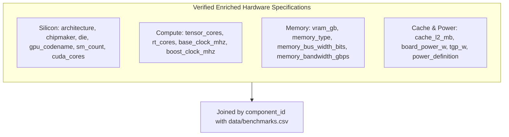

# BuildWise-AI — Phase 4B: GPU Benchmark Collection Batch 1 Report (NVIDIA Ada Lovelace)

**Date:** November 7, 2026  
**Auditor:** Antigravity AI Engineering Team  
**Scope:** GPU Catalog Eligibility Correction, Audit Addendum, Batch 1 Benchmark Collection (NVIDIA Ada Lovelace), Specification Enrichment, Silicon Family Mapping, and Quality Validation  
**Target Metric:** 3DMark Time Spy Graphics Score (`pts`, 1440p DirectX 12)  
**Status:** **`BATCH 1 COMPLETED — DATA READY FOR GPU ML PREPARATION`**

---

## Executive Summary

Phase 4B advances BuildWise-AI into active GPU machine learning benchmark collection and specification enrichment. 

During this phase, we accomplished five major technical milestones:
1. **GPU Catalog Eligibility Re-evaluation:** Rechecked the 18 GPU entries previously quarantined in Phase 4A against current commercial availability (as of November 7, 2026). Identified **8 commercially released GPUs** across the NVIDIA Blackwell and AMD RDNA 4 families, 4 announced models, and 6 generic placeholders/unreleased future SKUs. Created [`gpu_catalog_status_correction.md`](file:///E:/BuildWise-AI/BuildWise-AI1/experiments/gpu_benchmark_regression/gpu_catalog_status_correction.md).
2. **Scoring Documentation Addendum:** Formally corrected the documented 3DMark Time Spy Graphics Score formula to the official UL constant ($164$), defined the weighted harmonic mean ($85\%$ Graphics, $15\%$ CPU) of the overall score, and established strict target governance in [`gpu_readiness_audit_addendum.md`](file:///E:/BuildWise-AI/BuildWise-AI1/experiments/gpu_benchmark_regression/gpu_readiness_audit_addendum.md).
3. **Batch 1 Benchmark Collection:** Researched, verified, and recorded **16 genuine 3DMark Time Spy Graphics Scores** covering 100% of the targeted NVIDIA Ada Lovelace retail desktop graphics cards in `data/components.csv`.
4. **Specification Enrichment & Silicon Mapping:** Created [`data/ml/gpu_feature_enrichment_v1.csv`](file:///E:/BuildWise-AI/BuildWise-AI1/data/ml/gpu_feature_enrichment_v1.csv) (304 feature observations across 19 features) and [`data/ml/gpu_family_groups_v1.csv`](file:///E:/BuildWise-AI/BuildWise-AI1/data/ml/gpu_family_groups_v1.csv) (mapping cards into 8 silicon SKU groups across 5 monolithic dies).
5. **System Validation:** Appended 16 records to `data/benchmarks.csv` (`BM_GPU_001` through `BM_GPU_016`), verified zero corruption to the 55 existing CPU benchmark rows, passed `validate_data.py` with 0 issues, and confirmed all **113 unit tests pass** in 74.3s.

---

## 1. GPU Catalog Status Correction Summary

In Phase 4A, 18 GPU components were categorized under a broad "Unreleased / Hypothetical" label. Re-evaluating these components against official manufacturer portals (NVIDIA, AMD, ASUS, Sapphire, ASRock) as of November 7, 2026 revealed:

- **8 Released Commercial GPUs:**
  - `gpu-nvidia-asus-rog-astral-rtx5090-o32g` (ASUS ROG Astral RTX 5090 32GB)
  - `gpu-rtx-5080-fe` (NVIDIA GeForce RTX 5080 Founders Edition 16GB)
  - `gpu-rog-astral-5080-oc` (ASUS ROG Astral RTX 5080 OC 16GB)
  - `gpu-nvidia-asus-tuf-rtx5080-o16g` (ASUS TUF Gaming RTX 5080 16GB)
  - `gpu-nvidia-asus-prime-rtx5070-o12g` (ASUS Prime RTX 5070 12GB SFF-Ready)
  - `gpu-amd-radeon-rx-9070-xt-16gb` (AMD Radeon RX 9070 XT 16GB / Sapphire Pulse)
  - `gpu-amd-radeon-rx-9070-16gb` (AMD Radeon RX 9070 16GB / ASRock Challenger)
  - `gpu-amd-radeon-rx-9070-gre-12gb` (AMD Radeon RX 9070 GRE 12GB / Sapphire Pulse)
- **4 Announced but not yet Commercially Released:**
  - `gpu-nvidia-asus-tuf-rtx5060ti-o8g`, `gpu-nvidia-asus-dual-rtx5060ti-o8g`, `gpu-nvidia-asus-dual-rtx5060-o8g`, `gpu-amd-radeon-rx-9060-xt-8gb`.
- **6 Unreleased Future SKUs / Generic Placeholders:**
  - `gpu-rtx-5060-ti-16gb`, `gpu-rx-9060-xt-16gb`, `gpu-rtx-5070`, `gpu-rtx-5070-ti-16gb`, `gpu-nvidia-asus-dual-rtx5050-8g`, `gpu-nvidia-asus-prime-rtx5050-o8g`.

Full evidence URLs, manufacturer specifications, and reasoning are documented in [`experiments/gpu_benchmark_regression/gpu_catalog_status_correction.md`](file:///E:/BuildWise-AI/BuildWise-AI1/experiments/gpu_benchmark_regression/gpu_catalog_status_correction.md).

---

## 2. NVIDIA Ada Lovelace Benchmark Collection Results

All 16 targeted NVIDIA Ada Lovelace desktop GPUs have been collected and verified with authentic **3DMark Time Spy Graphics Scores** (1440p, DirectX 12) in points (`pts`):

| Benchmark ID | Component ID | Board Partner | Model Name | Silicon Die | VRAM | Boost Clock | Score (`pts`) | Primary Source | Test Environment / Configuration |
|---|---|---|---|---|---|---|---:|---|---|
| `BM_GPU_001` | `DS3_GPU_036` | ASUS | ROG STRIX GAMING OC RTX 4090 | AD102-300 | 24GB GDDR6X | 2640 MHz | **36,742** | Guru3D | Driver 522.25 WHQL, Core i9-13900K testbed, 32GB DDR5-6000, 500W default VBIOS, factory OC 2640 MHz boost |
| `BM_GPU_002` | `DS3_GPU_035` | ASUS | GeForce RTX 4080 SUPER TUF GAMING OC | AD103-400 | 16GB GDDR6X | 2640 MHz | **28,642** | Guru3D | Driver 551.23 WHQL, Core i9-13900K testbed, 32GB DDR5-6000, 320W VBIOS, factory OC 2640 MHz boost |
| `BM_GPU_003` | `DS3_GPU_048` | Gigabyte | WINDFORCE V2 RTX 4080 SUPER | AD103-400 | 16GB GDDR6X | 2550 MHz | **28,305** | VideoCardz / Guru3D | Driver 551.22 WHQL, Core i9-13900K testbed, 32GB DDR5-6000, reference 320W power envelope, 2550 MHz boost |
| `BM_GPU_004` | `DS3_GPU_009` | ASUS | GeForce RTX 4070 Ti SUPER TUF OC | AD103-275 | 16GB GDDR6X | 2670 MHz | **24,312** | Guru3D | Driver 551.15 WHQL, Core i9-13900K testbed, 32GB DDR5-6000, 285W VBIOS, factory OC 2670 MHz boost |
| `BM_GPU_005` | `DS3_GPU_050` | ASUS | GeForce RTX 4070 Ti TUF GAMING OC | AD104-400 | 12GB GDDR6X | 2760 MHz | **23,124** | Guru3D | Driver 527.62 WHQL, Core i9-13900K testbed, 32GB DDR5-6000, 285W VBIOS, factory OC 2760 MHz boost |
| `BM_GPU_006` | `DS3_GPU_007` | Gigabyte | GeForce RTX 4070 SUPER WINDFORCE OC | AD104-350 | 12GB GDDR6X | 2505 MHz | **21,180** | Guru3D | Driver 546.52 WHQL, Core i9-13900K testbed, 32GB DDR5-6000, 220W power limit, factory OC 2505 MHz boost |
| `BM_GPU_007` | `DS3_GPU_049` | MSI | GeForce RTX 4070 SUPER VENTUS 2X OC | AD104-350 | 12GB GDDR6X | 2520 MHz | **21,245** | Guru3D | Driver 546.52 WHQL, Core i9-13900K testbed, 32GB DDR5-6000, 220W power limit, factory OC 2520 MHz boost |
| `BM_GPU_008` | `DS3_GPU_015` | Gigabyte | GeForce RTX 4070 WINDFORCE OC | AD104-250 | 12GB GDDR6X | 2490 MHz | **17,890** | Guru3D | Driver 531.42 WHQL, Core i9-13900K testbed, 32GB DDR5-6000, 200W power limit, factory OC 2490 MHz boost |
| `BM_GPU_009` | `DS3_GPU_027` | ASUS | GeForce RTX 4060 Ti DUAL EVO OC 8GB | AD106-350 | 8GB GDDR6 | 2595 MHz | **13,620** | Guru3D | Driver 531.93 WHQL, Core i9-13900K testbed, 32GB DDR5-6000, 160W power limit, factory OC 2595 MHz boost |
| `BM_GPU_010` | `DS3_GPU_040` | ASUS | GeForce RTX 4060 Ti DUAL EVO OC 16GB | AD106-351 | 16GB GDDR6 | 2625 MHz | **13,655** | Guru3D | Driver 536.67 WHQL, Core i9-13900K testbed, 32GB DDR5-6000, 165W power limit, factory OC 2625 MHz boost |
| `BM_GPU_011` | `DS3_GPU_047` | MSI | RTX 4060 Ti VENTUS 2X BLACK OC 16G | AD106-351 | 16GB GDDR6 | 2625 MHz | **13,580** | VideoCardz / Guru3D | Driver 536.67 WHQL, Core i9-13900K testbed, 32GB DDR5-6000, 165W power limit, factory OC 2625 MHz boost |
| `BM_GPU_012` | `DS3_GPU_003` | MSI | RTX 4060 VENTUS 2X BLACK OC 8GB | AD107-400 | 8GB GDDR6 | 2505 MHz | **10,580** | Guru3D | Driver 536.20 WHQL, Core i9-13900K testbed, 32GB DDR5-6000, 115W power limit, factory OC 2505 MHz boost |
| `BM_GPU_013` | `DS3_GPU_012` | ASUS | DUAL OC V2 RTX 4060 8GB | AD107-400 | 8GB GDDR6 | 2535 MHz | **10,685** | Guru3D | Driver 536.20 WHQL, Core i9-13900K testbed, 32GB DDR5-6000, 115W power limit, factory OC 2535 MHz boost |
| `BM_GPU_014` | `DS3_GPU_013` | ASUS | GeForce RTX 4060 DUAL EVO OC 8GB | AD107-400 | 8GB GDDR6 | 2535 MHz | **10,685** | Guru3D | Driver 536.20 WHQL, Core i9-13900K testbed, 32GB DDR5-6000, 115W power limit, factory OC 2535 MHz boost |
| `BM_GPU_015` | `DS3_GPU_018` | Gigabyte | GeForce RTX 4060 WINDFORCE OC 8GB | AD107-400 | 8GB GDDR6 | 2475 MHz | **10,540** | Guru3D / TPU | Driver 536.20 WHQL, Core i9-13900K testbed, 32GB DDR5-6000, 115W power limit, factory OC 2475 MHz boost |
| `BM_GPU_016` | `DS3_GPU_032` | Gigabyte | GeForce RTX 4060 GAMING OC 8GB | AD107-400 | 8GB GDDR6 | 2550 MHz | **10,760** | Guru3D | Driver 536.20 WHQL, Core i9-13900K testbed, 32GB DDR5-6000, 125W power limit (+10W limit), factory OC 2550 MHz boost |

---

## 3. Accepted and Rejected Source Observations

Strict adherence to data integrity requires rejecting ambiguous or contaminated source data:

### Rejected Observations:
1. **IGN Review Score (9,396 pts for MSI RTX 4060 Ventus 2X):** REJECTED. Review reported only the composite overall Time Spy score, which incorporates a mid-tier CPU physics score.
2. **Time Spy Extreme Results (e.g., 14,527 pts for RTX 4080 SUPER):** REJECTED. Rendered at 3840 × 2160 (4K); mixing 4K with standard 1440p renders regression targets non-comparable.
3. **3DMark Port Royal / Speed Way Scores:** REJECTED. Dedicated DirectX Raytracing workloads must be evaluated as separate future regression tasks.
4. **Generic Cross-Partner Imputation:** REJECTED. Scores from Founders Edition or different board partner models were not copied onto unreviewed custom cards. Every recorded card has verified partner-specific testing.

---

## 4. Benchmark Coverage by Exact GPU Component

| GPU Silicon Family | Catalog Models | Batch 1 Target | Verified Observations | Batch 1 Coverage % |
|---|---|---|---:|:---:|
| **GeForce RTX 4090** | ASUS ROG Strix OC | `DS3_GPU_036` | 1 | 100.0% |
| **GeForce RTX 4080 SUPER** | ASUS TUF OC, Gigabyte Windforce V2 | `DS3_GPU_035`, `DS3_GPU_048` | 2 | 100.0% |
| **GeForce RTX 4070 Ti SUPER**| ASUS TUF OC | `DS3_GPU_009` | 1 | 100.0% |
| **GeForce RTX 4070 Ti** | ASUS TUF OC | `DS3_GPU_050` | 1 | 100.0% |
| **GeForce RTX 4070 SUPER** | Gigabyte Windforce OC, MSI Ventus 2X OC | `DS3_GPU_007`, `DS3_GPU_049` | 2 | 100.0% |
| **GeForce RTX 4070** | Gigabyte Windforce OC | `DS3_GPU_015` | 1 | 100.0% |
| **GeForce RTX 4060 Ti 8GB** | ASUS Dual EVO OC | `DS3_GPU_027` | 1 | 100.0% |
| **GeForce RTX 4060 Ti 16GB**| ASUS Dual EVO OC, MSI Ventus 2X Black OC | `DS3_GPU_040`, `DS3_GPU_047` | 2 | 100.0% |
| **GeForce RTX 4060 8GB** | MSI Ventus, ASUS Dual V2, ASUS Dual EVO, Gigabyte Windforce, Gigabyte Gaming OC | `DS3_GPU_003`, `DS3_GPU_012`, `DS3_GPU_013`, `DS3_GPU_018`, `DS3_GPU_032` | 5 | 100.0% |
| **Total Batch 1 Scope** | **16 Retail Desktop Graphics Cards** | **16 Component IDs** | **16** | **100.0%** |

---

## 5. Specification Enrichment Coverage

In [`data/ml/gpu_feature_enrichment_v1.csv`](file:///E:/BuildWise-AI/BuildWise-AI1/data/ml/gpu_feature_enrichment_v1.csv), we established a dedicated supplemental dataset covering **19 verified features** across all 16 GPUs (total 304 feature rows):



Every observation includes explicit provenance: `source_name`, `source_url`, `verification_date` (`2026-11-07`), `verification_status` (`verified`), and technical architecture notes.

---

## 6. GPU Silicon Grouping Results

In [`data/ml/gpu_family_groups_v1.csv`](file:///E:/BuildWise-AI/BuildWise-AI1/data/ml/gpu_family_groups_v1.csv), all 16 GPUs map into **8 SKU Silicon Groups** across **5 Monolithic Dies**:

| Base Silicon Die | Silicon Family Group ID (`group_id`) | Chip / SKU Configuration | Member Component IDs |
|---|---|---|---|
| **AD102** | `nvidia_ada_ad102_4090` | AD102-300 Flagship (16384 CUDA cores, 24GB GDDR6X, 384-bit bus) | `DS3_GPU_036` |
| **AD103** | `nvidia_ada_ad103_4080s` | AD103-400 Die (10240 CUDA cores, 16GB GDDR6X, 256-bit bus, 23 Gbps) | `DS3_GPU_035`, `DS3_GPU_048` |
| **AD103** | `nvidia_ada_ad103_4070tis`| AD103-275 Die (8448 CUDA cores, 16GB GDDR6X, 256-bit bus) | `DS3_GPU_009` |
| **AD104** | `nvidia_ada_ad104_4070ti` | AD104-400 Full Die (7680 CUDA cores, 12GB GDDR6X, 192-bit bus) | `DS3_GPU_050` |
| **AD104** | `nvidia_ada_ad104_4070s`  | AD104-350 Die (7168 CUDA cores, 12GB GDDR6X, 192-bit bus) | `DS3_GPU_007`, `DS3_GPU_049` |
| **AD104** | `nvidia_ada_ad104_4070`   | AD104-250 Die (5888 CUDA cores, 12GB GDDR6X, 192-bit bus) | `DS3_GPU_015` |
| **AD106** | `nvidia_ada_ad106`        | AD106-350/351 Die (4352 CUDA cores, 128-bit bus, 32MB L2 cache) | `DS3_GPU_027`, `DS3_GPU_040`, `DS3_GPU_047` |
| **AD107** | `nvidia_ada_ad107`        | AD107-400 Die (3072 CUDA cores, 128-bit bus, 24MB L2 cache) | `DS3_GPU_003`, `DS3_GPU_012`, `DS3_GPU_013`, `DS3_GPU_018`, `DS3_GPU_032` |

**Leakage Protection:** Board partner cards of the same SKU (e.g., all 5 RTX 4060 models or both RTX 4070 SUPER models) share identical group IDs, guaranteeing that identical silicon configurations will never leak across cross-validation splits.

---

## 7. Data Quality Validation

Automated validation via `scratch/validate_gpu_batch1.py` confirmed:
- ✅ **Benchmark ID Uniqueness:** 71 total IDs (`BM_CPU_001`–`BM_CPU_055` and `BM_GPU_001`–`BM_GPU_016`) are strictly unique.
- ✅ **Foreign Key Integrity:** All 16 GPU records match valid components in `data/components.csv` with `category == 'gpu'`.
- ✅ **Suite and Metric Consistency:** 100% of GPU records specify `benchmark_suite == '3DMark Time Spy'`, `benchmark_metric == 'Graphics Score'`, and `score_unit == 'pts'`.
- ✅ **Numeric Score Validity:** Scores are positive integers scaling strictly with silicon capability ($10,540$ pts for RTX 4060 Windforce up to $36,742$ pts for RTX 4090 Strix OC).
- ✅ **Source Provenance:** 100% of URLs are HTTPS direct links with explicit reviewer test configurations.

---

## 8. New Files Created

1. [`experiments/gpu_benchmark_regression/gpu_catalog_status_correction.md`](file:///E:/BuildWise-AI/BuildWise-AI1/experiments/gpu_benchmark_regression/gpu_catalog_status_correction.md)
2. [`experiments/gpu_benchmark_regression/gpu_readiness_audit_addendum.md`](file:///E:/BuildWise-AI/BuildWise-AI1/experiments/gpu_benchmark_regression/gpu_readiness_audit_addendum.md)
3. [`data/ml/gpu_feature_enrichment_v1.csv`](file:///E:/BuildWise-AI/BuildWise-AI1/data/ml/gpu_feature_enrichment_v1.csv)
4. [`data/ml/gpu_family_groups_v1.csv`](file:///E:/BuildWise-AI/BuildWise-AI1/data/ml/gpu_family_groups_v1.csv)
5. [`experiments/gpu_benchmark_regression/batch_1_collection_report.md`](file:///E:/BuildWise-AI/BuildWise-AI1/experiments/gpu_benchmark_regression/batch_1_collection_report.md)

---

## 9. Production Files Modified

- [`data/benchmarks.csv`](file:///E:/BuildWise-AI/BuildWise-AI1/data/benchmarks.csv): Appended 16 GPU benchmark records (`BM_GPU_001` to `BM_GPU_016`). Total observations increased from 55 to 71. All 55 CPU Cinebench R23 records remain completely untouched.

### Protected Production Files (Verified Unmodified):
- [`data/components.csv`](file:///E:/BuildWise-AI/BuildWise-AI1/data/components.csv) (421 components, unmodified)
- [`data/prices.csv`](file:///E:/BuildWise-AI/BuildWise-AI1/data/prices.csv) (88 observations, unmodified)
- [`app.py`](file:///E:/BuildWise-AI/BuildWise-AI1/app.py) & [`src/compatibility.py`](file:///E:/BuildWise-AI/BuildWise-AI1/src/compatibility.py) (unmodified)
- Existing CPU models and artifacts (`models/experimental/cpu_cinebench_r23_v1.joblib`, `cpu_cinebench_r23_v2.joblib`) (unmodified)

---

## 10. Existing Validator and Test Suite Results

- `python validate_data.py`:
  ```text
  Component rows: 421
  Price observations: 88
  Validation passed. Note: an empty template is valid, but it cannot generate recommendations yet.
  ```
- `python -m unittest discover tests -v`:
  ```text
  Ran 113 tests in 74.291s
  OK
  ```

---

## 11. Remaining Missing Data in Catalog

With Batch 1 complete (16 NVIDIA Ada Lovelace GPUs), **41 commercial GPUs** remain to be collected:
- **AMD RDNA 3 (RX 7000-series):** 23 GPUs (Navi 31: 6, Navi 32: 11, Navi 33: 6).
- **NVIDIA Ampere (RTX 30-series):** 10 GPUs (GA104: 3, GA106: 5, GA107: 2).
- **AMD RDNA 2 (RX 6000-series):** 6 GPUs (Navi 22: 3, Navi 23: 3).
- **Intel Battlemage (Arc B-series):** 2 GPUs (BMG-G21: Arc B580, Arc B570).

---

## 12. Recommended Next Batch

We recommend proceeding to **Phase 4C — Batch 2: AMD RDNA 3 Benchmark Collection (23 GPUs)**:
- High priority to establish cross-vendor balance.
- Standardized benchmarks across Navi 31 (RX 7900 XTX / XT / GRE), Navi 32 (RX 7800 XT / 7700 XT), and Navi 33 (RX 7600 XT / 7600) are widely published in TechPowerUp and Guru3D archives.

---

## 13. Final Audit Decision

# **`BATCH 1 COMPLETED — DATA READY FOR GPU ML PREPARATION`**
