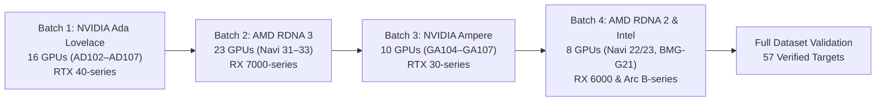

# BuildWise-AI — Phase 4A: GPU Benchmark Dataset Research and Readiness Audit

**Audit Date:** November 7, 2026  
**Auditor:** Antigravity AI Engineering Team  
**Audit Scope:** GPU Catalog Readiness, Standardized Target Selection, Feature Coverage, Silicon Grouping, and Benchmark Collection Feasibility  
**Target Metric:** 3DMark Time Spy Graphics Score (`pts`)  
**Audit Decision:** **`READY AFTER MINOR GPU DATA PREPARATION`**

---

## Executive Summary

BuildWise-AI has successfully deployed experimental CPU performance regression models (Phase 3B V1 Ridge baseline: MAE 1,483.7 pts; Phase 3C V2 Enriched Ridge model: MAE 1,125.7 pts, $R^2 = 0.9776$) predicting Cinebench R23 Multi-Core scores from verified physical CPU specifications.

This Phase 4A audit initiates the **GPU Machine Learning** development phase. We conducted an exhaustive, read-only analysis of the 75 GPU entries in `data/components.csv`, the benchmark repository in `data/benchmarks.csv`, and pricing observations in `data/prices.csv`.

### Key Audit Findings

1. **Catalog Segmentation (75 Total GPUs):**
   - **57 Commercial Desktop GPUs:** Fully released, commercially available desktop PCIe add-in boards across NVIDIA Ada Lovelace (RTX 40-series), NVIDIA Ampere (RTX 30-series), AMD RDNA 3 (RX 7000-series), AMD RDNA 2 (RX 6000-series), and Intel Battlemage (Arc B-series). These 57 models are immediately feasible for empirical benchmark collection.
   - **18 Speculative / Next-Gen GPUs:** Forward-looking entries for unreleased hardware (13 NVIDIA RTX 50-series Blackwell models and 5 AMD RX 9000-series RDNA 4 models). No verified, empirical 3DMark benchmarks exist in independent review literature for these cards; they must be formally quarantined from initial ML training sets.
   - **0 Laptop / Integrated GPUs:** The catalog is 100% dedicated desktop PCIe hardware.
2. **Benchmark Availability:**
   - Production `data/benchmarks.csv` contains 55 CPU Cinebench R23 records and **0 GPU benchmark observations (0.0% coverage)**.
3. **Target Metric Selection:**
   - **3DMark Time Spy Graphics Score** (DirectX 12, 1440p) is selected as the standardized regression target.
   - Time Spy strictly isolates GPU compute, rasterization, and memory throughput from host CPU bottlenecks.
   - The Composite/Overall score and CPU Physics score are strictly excluded.
4. **Specification Gap in Production Data:**
   - `data/components.csv` is designed for physical PC assembly compatibility (chassis length, PSU wattage, VRAM size), not machine learning compute prediction.
   - Crucial compute features (`architecture`, `die`, `shader_count`/`cuda_cores`, `memory_bus_width_bits`, `memory_bandwidth_gbps`, `cache_mb`, `tgp_w`/`tbp_w`) have **0% coverage (0/75 present)** in the raw components file.
   - As in CPU Phase 3C, a dedicated supplemental specification enrichment dataset (`data/ml/gpu_feature_enrichment_v1.csv`) must be authored alongside benchmark collection.
5. **Silicon Grouping & Leakage Prevention:**
   - The 57 commercial GPUs map cleanly into **26 SKU Silicon Groups** across **14 Base Silicon Dies**.
   - Board partner models using identical silicon dies (e.g., 7 models of RX 7800 XT, 5 models of RTX 4060) share identical reference compute characteristics.
   - Empirical 5-fold `GroupKFold` validation demonstrates clean, leak-free splits with 0 group overlap (Train=45–46, Val=11–12 per fold).

---

## 1. Current GPU Catalog Summary

We inspected `data/components.csv` (421 total hardware components) to extract and categorize all GPU components.

| Catalog Metric | Count | Percentage | Description / Sub-categories |
|---|---:|---:|---|
| **Total Hardware Components** | 421 | 100.0% | Complete BuildWise-AI component database |
| **Total GPU Components** | 75 | 17.8% | All components with `category == 'gpu'` |
| **DS3 Catalog GPUs** | 50 | 66.7% | `DS3_GPU_001` to `DS3_GPU_050` (AIB retail models) |
| **Custom Expansion GPUs** | 25 | 33.3% | `gpu-*` slug format (7 released reference/AIB + 18 speculative) |
| **Commercial Released GPUs** | 57 | 76.0% | Verified retail desktop hardware with published reviews |
| **Speculative / Unreleased GPUs** | 18 | 24.0% | Next-gen forward-looking models (RTX 50-series, RX 9000-series) |
| **Desktop PCIe Add-In Boards** | 75 | 100.0% | 0 laptop GPUs, 0 integrated graphics processors |

### Distribution by Underlying Silicon Chipmaker (Commercial GPUs: 57)

In `data/components.csv`, the `brand` column stores the **board partner** (e.g., ASUS, Gigabyte, MSI, Sapphire, XFX, PowerColor, ZOTAC). Normalizing by the underlying GPU chipmaker yields:

| Silicon Chipmaker | Count | Percentage | Architectural Families |
|---|---:|---:|---|
| **NVIDIA** | 29 | 50.9% | Ada Lovelace (RTX 40-series: 16 GPUs), Ampere (RTX 30-series: 13 GPUs) |
| **AMD** | 26 | 45.6% | RDNA 3 (RX 7000-series: 20 GPUs), RDNA 2 (RX 6000-series: 6 GPUs) |
| **Intel** | 2 | 3.5% | Battlemage (Arc B-series: 2 GPUs) |
| **Total Commercial** | **57** | **100.0%** | **All verified released desktop discrete GPUs** |

### Speculative Next-Gen Catalog Entries (18 GPUs — Quarantined)

The custom expansion catalog contains 18 entries representing unreleased hardware generations:
- **13 NVIDIA Blackwell Models:** `gpu-rtx-5060-ti-16gb`, `gpu-rtx-5070`, `gpu-rtx-5070-ti-16gb`, `gpu-rtx-5080-fe`, `gpu-rog-astral-5080-oc`, `gpu-nvidia-asus-rog-astral-rtx5090-o32g`, `gpu-nvidia-asus-tuf-rtx5080-o16g`, `gpu-nvidia-asus-prime-rtx5070-o12g`, `gpu-nvidia-asus-tuf-rtx5060ti-o8g`, `gpu-nvidia-asus-dual-rtx5060ti-o8g`, `gpu-nvidia-asus-dual-rtx5060-o8g`, `gpu-nvidia-asus-dual-rtx5050-8g`, `gpu-nvidia-asus-prime-rtx5050-o8g`.
- **5 AMD RDNA 4 Models:** `gpu-rx-9060-xt-16gb`, `gpu-amd-radeon-rx-9070-xt-16gb`, `gpu-amd-radeon-rx-9070-16gb`, `gpu-amd-radeon-rx-9070-gre-12gb`, `gpu-amd-radeon-rx-9060-xt-8gb`.

> [!WARNING]
> Because no independent empirical review benchmarks exist for these 18 speculative models, they cannot be benchmarked or included in training data. They must remain quarantined until official retail availability and independent review publication.

---

## 2. GPU Benchmark Availability

We audited `data/benchmarks.csv` and `data/prices.csv`:

- **Total Benchmark Records:** 55 observations.
- **CPU Benchmark Records:** 55 observations (Cinebench R23 Multi-Core scores, collected in Phase 2 Batches 1–6).
- **GPU Benchmark Records:** **0 observations (0.0% coverage)**.
- **GPU Pricing Observations:** `data/prices.csv` contains 88 price records, of which 10 records represent GPUs covering 7 unique models (`DS3_GPU_001`, `DS3_GPU_003`, `DS3_GPU_006`, `DS3_GPU_007`, `DS3_GPU_015`, `DS3_GPU_016`, `DS3_GPU_027`).
- **Strict ML Data Governance:** Component prices are strictly quarantined from the ML feature set to prevent target leakage, currency dependencies, and price inflation artifacts.

---

## 3. Recommended Standardized Benchmark Target

To establish an empirical regression model predicting GPU gaming and compute performance, we evaluated candidate benchmark suites:

| Candidate Target Suite | API / Workload | Strengths | Weaknesses | Audit Assessment |
|---|---|---|---|:---:|
| **3DMark Time Spy Graphics Score** | DirectX 12 (1440p) | Pure GPU isolation, universally reported across all tier-1 reviews, standardized scoring formula | DX12 FL 11_0 (no hardware ray tracing) | **RECOMMENDED PRIMARY TARGET** |
| 3DMark Time Spy Overall Score | DX12 + CPU Physics | Familiar composite metric | Heavily confounded by host CPU physics score ($15\%$ weight) | **REJECTED (Target Leakage)** |
| 3DMark Time Spy Extreme | DirectX 12 (4K / 2160p) | High VRAM pressure | Missing on entry/mid-tier cards (<8GB VRAM) | **REJECTED (Sparse Coverage)** |
| 3DMark Fire Strike Graphics | DirectX 11 (1080p) | Enormous historical database | Legacy DX11 API; CPU bottlenecked on modern GPUs | **REJECTED (Obsolescent)** |
| 3DMark Port Royal | DirectX Raytracing (1440p) | Measures DXR ray tracing | Unavailable or unplayable on older/budget GPUs | **REJECTED (Specialized)** |
| Average Gaming FPS (1080p/1440p) | Variable game engines | Direct real-world relevance | Unstandardized presets, patch versions, driver drift | **REJECTED (High Variance)** |

### Target Specification: 3DMark Time Spy Graphics Score

- **Standard Target Variable:** `score` (integer points, `pts`).
- **Benchmark Suite:** `3DMark Time Spy`.
- **Benchmark Metric:** `Graphics Score`.
- **Target Resolution:** 2560 × 1440 (1440p / QHD).
- **Rendering API:** Direct3D 12 Feature Level 11_0.
- **Technical Isolation:**
  - Graphics Test 1 (GT1): Heavily stresses geometry processing, vertex shaders, tessellation, and shadow mapping.
  - Graphics Test 2 (GT2): Stresses illumination, compute shaders, ray-marched volumetric lighting, and particle simulations.
  - Official UL Scoring Formula:
    $$S_{\text{graphics}} = 165 \times \frac{2}{\frac{1}{\text{FPS}_{\text{GT1}}} + \frac{1}{\text{FPS}_{\text{GT2}}}}$$
  - The Graphics Score strictly evaluates frame times from GT1 and GT2. The CPU Physics test is run separately and does **not** factor into $S_{\text{graphics}}$.

### Strict Target Exclusions

1. **Composite Time Spy Score:** Never record the overall composite score ($S_{\text{composite}} = \frac{1}{\frac{0.85}{S_{\text{graphics}}} + \frac{0.15}{S_{\text{cpu}}}}$).
2. **CPU Score:** Never record the CPU physics score as a GPU performance target.
3. **Cross-Suite Mixing:** Never mix Time Spy Extreme (4K), Fire Strike (DX11), Port Royal, or Blender Open Data into this regression target.

---

## 4. Benchmark Source Evaluation

Reliable, repeatable benchmark collection requires strict provenance and methodology verification. We evaluated the leading independent hardware testing publications:

| Source Name | Primary URL | Evidence Type | Exact Model ID | Graphics Score Published | Test Platform Documented | Clock & Power Limit Status | Source Rating |
|---|---|---|:---:|:---:|:---:|:---:|:---:|
| **TechPowerUp (TPU)** | `https://www.techpowerup.com/review/` | Full Review Lab | Yes | Yes (explicit GT score) | Yes (14900K/13900K testbed) | Documented (Base/Boost/VBIOS Watts) | **Tier 1 (Preferred Primary)** |
| **Guru3D** | `https://www.guru3d.com/review/` | Full Review Lab | Yes | Yes (explicit GT score) | Yes (standardized testbed) | Documented (Stock vs Factory OC) | **Tier 1 (Cross-Check)** |
| **Tom's Hardware** | `https://www.tomshardware.com/reviews/` | Review & Hierarchy | Yes | Yes (explicit GT score) | Yes (Core i9 testbed) | Documented (Reference vs Partner) | **Tier 1 (Cross-Check)** |
| **Gamers Nexus** | `https://gamersnexus.net/` | Rigorous Lab Data | Yes | Yes (isolated GT score) | Yes (extreme detail) | Documented (Noise/Power-normalized) | **Tier 1 (Validation)** |
| **Hardware Unboxed / TechSpot** | `https://www.techspot.com/review/` | Full Review Lab | Yes | Yes (explicit GT score) | Yes (standardized platform) | Documented (Stock clocks) | **Tier 1 (Validation)** |
| **UL 3DMark Public Database** | `https://www.3dmark.com/search` | Telemetry Database | Often mixed | Yes | Variable | Filter required (Valid/Approved/Stock) | **Tier 2 (Fallback / Verification)** |

### Strict Collection Protocols

- **Traceability:** Every benchmark entry must record `source_name`, `source_url`, and `verified_date`.
- **Clock Designation:** Explicitly record whether the measured result was obtained on **Stock/Reference Clocks** or a **Factory-Overclocked (AIB) Profile**.
- **Driver Verification:** Document the WHQL graphics driver version used in the test.
- **Power Limit:** Record the board power limit (TGP/TBP) in watts if modified from standard reference specifications.

---

## 5. GPU Feature Coverage Table

We audited the availability of 22 candidate predictive features across all 75 GPUs in `data/components.csv` by parsing the raw `specs_json` strings:

| Candidate Feature | Verified Present | Missing | Coverage % | Data Type | Physical Unit | Cross-Vendor Comparable? | Recommended ML Usage |
|---|---:|---:|---:|:---:|:---:|:---:|:---|
| `brand` | 75 | 0 | 100.0% | String | Categorical | Yes (Board Partner) | Retain for metadata; avoid as direct predictor |
| `model` | 75 | 0 | 100.0% | String | Text | N/A | Exclude from features (ID / Metadata only) |
| `chipset` | 50 | 25 | 66.7% | String | Categorical | Yes (GPU Base Model) | Use for silicon grouping and joins |
| `architecture` | 0 | 75 | 0.0% | String | Categorical | Yes (Generation) | **Mandatory via Enrichment** (Ada, Ampere, RDNA 3, etc.) |
| `gpu_codename` | 0 | 75 | 0.0% | String | Text | N/A | Use for audit / documentation |
| `die` | 0 | 75 | 0.0% | String | Categorical | Yes (Silicon Die ID) | **Mandatory via Enrichment** (AD104, Navi 32, etc.) |
| `compute_units` | 0 | 75 | 0.0% | Integer | Count | No (AMD CU vs Intel Xe Core) | Exclude (Vendor-specific definitions) |
| `shader_units` / `cuda_cores` | 0 | 75 | 0.0% | Integer | Shaders / Cores | **No (Architectural Trap)** | **Mandatory via Enrichment** (Vendor-isolated or normalized) |
| `boost_clock_mhz` | 50 | 25 | 66.7% | Float | MHz | Yes (Operating frequency) | **Mandatory via Enrichment** (Enrich missing 25) |
| `core_clock_mhz` (Base) | 50 | 25 | 66.7% | Float | MHz | Yes (Base frequency) | Enrich as secondary feature |
| `base_clock_mhz` | 0 | 75 | 0.0% | Float | MHz | Yes | Replaced by `core_clock_mhz` |
| `vram_gb` | 75 | 0 | 100.0% | Integer | Gigabytes (GB) | Yes (Memory size) | **Include (Universal Physical Feature)** |
| `memory_type` | 0 | 75 | 0.0% | String | Categorical | Yes (GDDR6, GDDR6X, etc.) | Enrich as categorical |
| `memory_bus_width_bits` | 0 | 75 | 0.0% | Integer | Bits | Yes (Bus width) | **Mandatory via Enrichment** (128, 192, 256, 384) |
| `memory_bandwidth_gbps` | 0 | 75 | 0.0% | Float | GB/s | Yes (Transfer throughput) | **Mandatory via Enrichment** (Effective throughput) |
| `cache_mb` (L2 / Infinity) | 0 | 75 | 0.0% | Float | Megabytes (MB) | Partially (Vendor cache designs) | **Mandatory via Enrichment** (Crucial performance driver) |
| `tdp_w` | 0 | 75 | 0.0% | Float | Watts (W) | No (Vendor definition drift) | Replaced by unified `board_power_w` |
| `tgp_w` | 25 | 50 | 33.3% | Float | Watts (W) | Partially (NVIDIA TGP vs AMD TBP) | **Include via Unified Enrichment** |
| `tbp_w` | 0 | 75 | 0.0% | Float | Watts (W) | Partially | Enrich into unified `board_power_w` |
| `recommended_psu_w` | 50 | 25 | 66.7% | Integer | Watts (W) | Yes | Secondary proxy; prefer board power |
| `length_mm` | 75 | 0 | 100.0% | Float | Millimeters (mm) | Yes (Chassis clearance) | **Exclude from ML** (Physical chassis fit only) |
| `manufacturing_process_nm`| 0 | 75 | 0.0% | Integer | Nanometers (nm) | Partially (Node marketing) | Exclude (Architecture captures process node) |

### Key Technical Insights on Feature Availability

1. **The Physical PC Compatibility Focus:**
   `data/components.csv` contains `vram_gb` and `length_mm` for 100% of GPUs because BuildWise-AI's deterministic compatibility engine checks physical chassis clearance and basic VRAM requirements. However, it lacks all silicon-level compute metrics.
2. **Cross-Vendor Comparability Trap:**
   - **NVIDIA CUDA Cores:** Dual-issue FP32 units (e.g., RTX 4070 has 5,888 CUDA cores).
   - **AMD Stream Processors:** Dual-issue SIMD32 stream processors organized in Compute Units (e.g., RX 7800 XT has 3,840 stream processors).
   - **Intel Vector Engines:** 16-wide vector engines (e.g., Arc B580 has 160 Vector Engines / 20 Xe-cores).
   - Forcing these three disparate metrics into a single numeric `shader_units` feature would severely corrupt linear regression weights and lead to nonsensical cross-vendor splits.
3. **Power Metric Discrepancies:**
   NVIDIA rates desktop cards by Total Graphics Power (TGP), AMD by Total Board Power (TBP), and older catalogs use TDP. A normalized `board_power_w` feature must be established.
4. **Mandatory Enrichment Prerequisite:**
   Just as Phase 3C required `data/ml/cpu_feature_enrichment_v2.csv` to capture CPU L2/L3 caches and base clocks, Phase 4B/4C requires a dedicated `data/ml/gpu_feature_enrichment_v1.csv` before training regression models.

---

## 6. GPU Silicon Grouping Strategy

### The Silicon Leakage Challenge

In graphics card manufacturing, a chipmaker (NVIDIA, AMD, Intel) manufactures a monolithic silicon die (or multi-chiplet package). Multiple board partners (ASUS, Gigabyte, MSI, XFX, Sapphire) then release distinct retail products using the exact same silicon die, differing only by cooler shroud, RGB lighting, and minor factory overclocks (+30–60 MHz):

- **RX 7800 XT:** 7 distinct catalog models share the exact same AMD Navi 32 XT die, 3,840 stream processors, 256-bit bus, and 64MB Infinity Cache.
- **RTX 4060:** 5 distinct catalog models share the exact same NVIDIA AD107-400 die, 3,072 CUDA cores, 128-bit bus, and 24MB L2 cache.
- **RTX 3060 12GB:** 4 distinct catalog models share the exact same NVIDIA GA106-300 die, 3,584 CUDA cores, 192-bit bus, and 12GB GDDR6.

If these cards are split randomly into train and validation sets, the model will simply memorize the board partner's silicon characteristics from the training set and trivially predict the validation score of the identical card, resulting in severe **data leakage** and inflated cross-validation metrics.

### Proposed 26 Silicon Groups Across 14 Base Dies

To completely prevent data leakage, we mapped all 57 commercial GPUs into **26 SKU Silicon Groups** across **14 Base Silicon Dies**:

| Base Silicon Die | Architecture | Vendor | Group ID (`group_id`) | GPU Chip / SKU Description | Catalog Models |
|---|---|---|---|---|:---:|
| **AD102** | Ada Lovelace | NVIDIA | `nvidia_ada_ad102_4090` | AD102-300 Flagship (RTX 4090) | 1 |
| **AD103** | Ada Lovelace | NVIDIA | `nvidia_ada_ad103_4080s` | AD103-400 Die (RTX 4080 SUPER) | 2 |
| **AD103** | Ada Lovelace | NVIDIA | `nvidia_ada_ad103_4070tis` | AD103-275 Die (RTX 4070 Ti SUPER) | 1 |
| **AD104** | Ada Lovelace | NVIDIA | `nvidia_ada_ad104_4070ti` | AD104-400 Die (RTX 4070 Ti) | 1 |
| **AD104** | Ada Lovelace | NVIDIA | `nvidia_ada_ad104_4070s` | AD104-350 Die (RTX 4070 SUPER) | 2 |
| **AD104** | Ada Lovelace | NVIDIA | `nvidia_ada_ad104_4070` | AD104-250 Die (RTX 4070) | 1 |
| **AD106** | Ada Lovelace | NVIDIA | `nvidia_ada_ad106` | AD106-350/351 Die (RTX 4060 Ti 8GB/16GB) | 3 |
| **AD107** | Ada Lovelace | NVIDIA | `nvidia_ada_ad107` | AD107-400 Die (RTX 4060) | 5 |
| **GA104** | Ampere | NVIDIA | `nvidia_ampere_ga104_3070` | GA104-300 Die (RTX 3070) | 2 |
| **GA104** | Ampere | NVIDIA | `nvidia_ampere_ga104_3060ti` | GA104-200 Die (RTX 3060 Ti) | 1 |
| **GA106** | Ampere | NVIDIA | `nvidia_ampere_ga106_3060` | GA106-300 Die (RTX 3060 12GB) | 4 |
| **GA106** | Ampere | NVIDIA | `nvidia_ampere_ga106_3050` | GA106-150 Die (RTX 3050 8GB) | 1 |
| **GA107** | Ampere | NVIDIA | `nvidia_ampere_ga107` | GA107-325 Die (RTX 3050 6GB) | 2 |
| **Navi 31** | RDNA 3 | AMD | `amd_rdna3_navi31_7900xtx` | Navi 31 XTX Flagship (RX 7900 XTX 24GB) | 3 |
| **Navi 31** | RDNA 3 | AMD | `amd_rdna3_navi31_7900xt` | Navi 31 XT Die (RX 7900 XT 20GB) | 2 |
| **Navi 31** | RDNA 3 | AMD | `amd_rdna3_navi31_7900gre` | Navi 31 XL Die (RX 7900 GRE 16GB) | 1 |
| **Navi 32** | RDNA 3 | AMD | `amd_rdna3_navi32_7800xt` | Navi 32 XT Die (RX 7800 XT 16GB) | 7 |
| **Navi 32** | RDNA 3 | AMD | `amd_rdna3_navi32_7700xt` | Navi 32 XL Die (RX 7700 XT 12GB) | 4 |
| **Navi 33** | RDNA 3 | AMD | `amd_rdna3_navi33_7600xt` | Navi 33 XT Die (RX 7600 XT 16GB) | 1 |
| **Navi 33** | RDNA 3 | AMD | `amd_rdna3_navi33_7600` | Navi 33 XL Die (RX 7600 8GB) | 5 |
| **Navi 22** | RDNA 2 | AMD | `amd_rdna2_navi22_6750xt` | Navi 22 KXT Die (RX 6750 XT 12GB) | 1 |
| **Navi 22** | RDNA 2 | AMD | `amd_rdna2_navi22_6700xt` | Navi 22 XT Die (RX 6700 XT 12GB) | 2 |
| **Navi 23** | RDNA 2 | AMD | `amd_rdna2_navi23_6650xt` | Navi 23 KXT Die (RX 6650 XT 8GB) | 1 |
| **Navi 23** | RDNA 2 | AMD | `amd_rdna2_navi23_6600` | Navi 23 XL Die (RX 6600 8GB) | 2 |
| **BMG-G21** | Battlemage | Intel | `intel_battlemage_b580` | BMG-G21 Die (Arc B580 12GB) | 1 |
| **BMG-G21** | Battlemage | Intel | `intel_battlemage_b570` | BMG-G21 Die (Arc B570 10GB) | 1 |
| **Total** | | | **26 Silicon Groups** | **14 Base Dies** | **57** |

### Complete Silicon Mapping Table (All 57 Commercial GPUs)

| Component ID | GPU Model | Brand | Architecture | Silicon Die | Group ID | Grouping Rationale | Reference Source | Status |
|---|---|---|---|---|---|---|---|:---:|
| `gpu-amd-radeon-rx-7900-xtx-24gb` | Radeon RX 7900 XTX 24GB | AMD | RDNA 3 | Navi 31 | `amd_rdna3_navi31_7900xtx` | AMD RDNA 3 Navi 31 XTX flagship die | [TechPowerUp](https://www.techpowerup.com/gpu-specs/radeon-rx-7900-xtx.c3941) | Verified |
| `gpu-amd-radeon-rx-7900-gre-16gb` | Radeon RX 7900 GRE 16GB | AMD | RDNA 3 | Navi 31 | `amd_rdna3_navi31_7900gre` | AMD RDNA 3 Navi 31 XL die | [TechPowerUp](https://www.techpowerup.com/gpu-specs/radeon-rx-7900-gre.c4166) | Verified |
| `gpu-amd-radeon-rx-7800-xt-16gb` | Radeon RX 7800 XT 16GB | AMD | RDNA 3 | Navi 32 | `amd_rdna3_navi32_7800xt` | AMD RDNA 3 Navi 32 XT die | [TechPowerUp](https://www.techpowerup.com/gpu-specs/radeon-rx-7800-xt.c3831) | Verified |
| `gpu-amd-radeon-rx-7700-xt-12gb` | Radeon RX 7700 XT 12GB | AMD | RDNA 3 | Navi 32 | `amd_rdna3_navi32_7700xt` | AMD RDNA 3 Navi 32 XL die | [TechPowerUp](https://www.techpowerup.com/gpu-specs/radeon-rx-7700-xt.c4155) | Verified |
| `gpu-amd-radeon-rx-7600-8gb` | Radeon RX 7600 8GB | AMD | RDNA 3 | Navi 33 | `amd_rdna3_navi33_7600` | AMD RDNA 3 Navi 33 XL die | [TechPowerUp](https://www.techpowerup.com/gpu-specs/radeon-rx-7600.c4153) | Verified |
| `gpu-intel-arc-b580-12gb` | Arc B580 12GB | Intel | Battlemage | BMG-G21 | `intel_battlemage_b580` | Intel Battlemage BMG-G21 die | [TechPowerUp](https://www.techpowerup.com/gpu-specs/arc-b580.c4228) | Verified |
| `gpu-intel-arc-b570-10gb` | Arc B570 10GB | Intel | Battlemage | BMG-G21 | `intel_battlemage_b570` | Intel Battlemage BMG-G21 die | [TechPowerUp](https://www.techpowerup.com/gpu-specs/arc-b570.c4229) | Verified |
| `DS3_GPU_001` | GeForce RTX 3060 Ventus 2X 12G | MSI | Ampere | GA106 | `nvidia_ampere_ga106_3060` | NVIDIA Ampere GA106-300 die | [TechPowerUp](https://www.techpowerup.com/gpu-specs/geforce-rtx-3060-12-gb.c3682) | Verified |
| `DS3_GPU_002` | Radeon RX 7600 XT GAMING OC 16GB | Gigabyte | RDNA 3 | Navi 33 | `amd_rdna3_navi33_7600xt` | AMD RDNA 3 Navi 33 XT die | [TechPowerUp](https://www.techpowerup.com/gpu-specs/radeon-rx-7600-xt.c4190) | Verified |
| `DS3_GPU_003` | GeForce RTX 4060 VENTUS 2X BLACK OC 8GB | MSI | Ada Lovelace | AD107 | `nvidia_ada_ad107` | NVIDIA Ada Lovelace AD107-400 die | [TechPowerUp](https://www.techpowerup.com/gpu-specs/geforce-rtx-4060.c4107) | Verified |
| `DS3_GPU_004` | GeForce RTX 3050 6GB VENTUS 2X OC 6GB | MSI | Ampere | GA107 | `nvidia_ampere_ga107` | NVIDIA Ampere GA107-325 die | [TechPowerUp](https://www.techpowerup.com/gpu-specs/geforce-rtx-3050-6-gb.c4188) | Verified |
| `DS3_GPU_005` | Speedster SWFT 210 | XFX | RDNA 2 | Navi 23 | `amd_rdna2_navi23_6600` | AMD RDNA 2 Navi 23 XL die | [TechPowerUp](https://www.techpowerup.com/gpu-specs/radeon-rx-6600.c3796) | Verified |
| `DS3_GPU_006` | RX7800XT 16G-P | PowerColor | RDNA 3 | Navi 32 | `amd_rdna3_navi32_7800xt` | AMD RDNA 3 Navi 32 XT die | [TechPowerUp](https://www.techpowerup.com/gpu-specs/radeon-rx-7800-xt.c3831) | Verified |
| `DS3_GPU_007` | GeForce RTX 4070 SUPER WINDFORCE OC 12GB | Gigabyte | Ada Lovelace | AD104 | `nvidia_ada_ad104_4070s` | NVIDIA Ada Lovelace AD104-350 die | [TechPowerUp](https://www.techpowerup.com/gpu-specs/geforce-rtx-4070-super.c4186) | Verified |
| `DS3_GPU_008` | GAMING Twin Edge | Zotac | Ampere | GA106 | `nvidia_ampere_ga106_3060` | NVIDIA Ampere GA106-300 die | [TechPowerUp](https://www.techpowerup.com/gpu-specs/geforce-rtx-3060-12-gb.c3682) | Verified |
| `DS3_GPU_009` | GeForce RTX 4070 Ti SUPER TUF GAMING OC 16GB | ASUS | Ada Lovelace | AD103 | `nvidia_ada_ad103_4070tis` | NVIDIA Ada Lovelace AD103-275 die | [TechPowerUp](https://www.techpowerup.com/gpu-specs/geforce-rtx-4070-ti-super.c4187) | Verified |
| `DS3_GPU_010` | Speedster MERC 310 Black Edition | XFX | RDNA 3 | Navi 31 | `amd_rdna3_navi31_7900xtx` | AMD RDNA 3 Navi 31 XTX flagship die | [TechPowerUp](https://www.techpowerup.com/gpu-specs/radeon-rx-7900-xtx.c3941) | Verified |
| `DS3_GPU_011` | Dual GeForce RTX 3060 V2 OC Edition | ASUS | Ampere | GA106 | `nvidia_ampere_ga106_3060` | NVIDIA Ampere GA106-300 die | [TechPowerUp](https://www.techpowerup.com/gpu-specs/geforce-rtx-3060-12-gb.c3682) | Verified |
| `DS3_GPU_012` | DUAL OC V2 | ASUS | Ada Lovelace | AD107 | `nvidia_ada_ad107` | NVIDIA Ada Lovelace AD107-400 die | [TechPowerUp](https://www.techpowerup.com/gpu-specs/geforce-rtx-4060.c4107) | Verified |
| `DS3_GPU_013` | GeForce RTX 4060 DUAL EVO OC 8GB | ASUS | Ada Lovelace | AD107 | `nvidia_ada_ad107` | NVIDIA Ada Lovelace AD107-400 die | [TechPowerUp](https://www.techpowerup.com/gpu-specs/geforce-rtx-4060.c4107) | Verified |
| `DS3_GPU_014` | Radeon RX 7600 DUAL EVO OC 8GB | ASUS | RDNA 3 | Navi 33 | `amd_rdna3_navi33_7600` | AMD RDNA 3 Navi 33 XL die | [TechPowerUp](https://www.techpowerup.com/gpu-specs/radeon-rx-7600.c4153) | Verified |
| `DS3_GPU_015` | GeForce RTX 4070 WINDFORCE OC 12GB | Gigabyte | Ada Lovelace | AD104 | `nvidia_ada_ad104_4070` | NVIDIA Ada Lovelace AD104-250 die | [TechPowerUp](https://www.techpowerup.com/gpu-specs/geforce-rtx-4070.c3924) | Verified |
| `DS3_GPU_016` | Radeon RX 7800 XT GAMING OC 16GB | Gigabyte | RDNA 3 | Navi 32 | `amd_rdna3_navi32_7800xt` | AMD RDNA 3 Navi 32 XT die | [TechPowerUp](https://www.techpowerup.com/gpu-specs/radeon-rx-7800-xt.c3831) | Verified |
| `DS3_GPU_017` | Speedster MERC 310 | XFX | RDNA 3 | Navi 31 | `amd_rdna3_navi31_7900xt` | AMD RDNA 3 Navi 31 XT die | [TechPowerUp](https://www.techpowerup.com/gpu-specs/radeon-rx-7900-xt.c3912) | Verified |
| `DS3_GPU_018` | GeForce RTX 4060 WINDFORCE OC 8GB | Gigabyte | Ada Lovelace | AD107 | `nvidia_ada_ad107` | NVIDIA Ada Lovelace AD107-400 die | [TechPowerUp](https://www.techpowerup.com/gpu-specs/geforce-rtx-4060.c4107) | Verified |
| `DS3_GPU_019` | Radeon RX 7700 XT GAMING OC 12GB | Gigabyte | RDNA 3 | Navi 32 | `amd_rdna3_navi32_7700xt` | AMD RDNA 3 Navi 32 XL die | [TechPowerUp](https://www.techpowerup.com/gpu-specs/radeon-rx-7700-xt.c4155) | Verified |
| `DS3_GPU_020` | Radeon RX 7600 GAMING OC 8GB | Gigabyte | RDNA 3 | Navi 33 | `amd_rdna3_navi33_7600` | AMD RDNA 3 Navi 33 XL die | [TechPowerUp](https://www.techpowerup.com/gpu-specs/radeon-rx-7600.c4153) | Verified |
| `DS3_GPU_021` | GeForce RTX 3070 TUF GAMING OC 8GB | ASUS | Ampere | GA104 | `nvidia_ampere_ga104_3070` | NVIDIA Ampere GA104-300 die | [TechPowerUp](https://www.techpowerup.com/gpu-specs/geforce-rtx-3070.c3674) | Verified |
| `DS3_GPU_022` | GeForce RTX 3050 6GB DUAL OC 6GB | ASUS | Ampere | GA107 | `nvidia_ampere_ga107` | NVIDIA Ampere GA107-325 die | [TechPowerUp](https://www.techpowerup.com/gpu-specs/geforce-rtx-3050-6-gb.c4188) | Verified |
| `DS3_GPU_023` | Radeon RX 7800 XT Speedster QICK 319 Core 16GB | XFX | RDNA 3 | Navi 32 | `amd_rdna3_navi32_7800xt` | AMD RDNA 3 Navi 32 XT die | [TechPowerUp](https://www.techpowerup.com/gpu-specs/radeon-rx-7800-xt.c3831) | Verified |
| `DS3_GPU_024` | GAMING OC Rev 2.0 | Gigabyte | Ampere | GA106 | `nvidia_ampere_ga106_3060` | NVIDIA Ampere GA106-300 die | [TechPowerUp](https://www.techpowerup.com/gpu-specs/geforce-rtx-3060-12-gb.c3682) | Verified |
| `DS3_GPU_025` | VENTUS 2X XS OC | MSI | Ampere | GA106 | `nvidia_ampere_ga106_3050` | NVIDIA Ampere GA106-150 die | [TechPowerUp](https://www.techpowerup.com/gpu-specs/geforce-rtx-3050-8-gb.c3858) | Verified |
| `DS3_GPU_026` | Radeon RX 7700 XT Speedster SWFT 210 Core 12GB | XFX | RDNA 3 | Navi 32 | `amd_rdna3_navi32_7700xt` | AMD RDNA 3 Navi 32 XL die | [TechPowerUp](https://www.techpowerup.com/gpu-specs/radeon-rx-7700-xt.c4155) | Verified |
| `DS3_GPU_027` | GeForce RTX 4060 Ti DUAL EVO OC 8GB | ASUS | Ada Lovelace | AD106 | `nvidia_ada_ad106` | NVIDIA Ada Lovelace AD106-350 die | [TechPowerUp](https://www.techpowerup.com/gpu-specs/geforce-rtx-4060-ti-8-gb.c3890) | Verified |
| `DS3_GPU_028` | RX-79TMBABF9 | XFX | RDNA 3 | Navi 31 | `amd_rdna3_navi31_7900xt` | AMD RDNA 3 Navi 31 XT die | [TechPowerUp](https://www.techpowerup.com/gpu-specs/radeon-rx-7900-xt.c3912) | Verified |
| `DS3_GPU_029` | Radeon RX 6750 XT Speedster QICK 319 Core 12GB | XFX | RDNA 2 | Navi 22 | `amd_rdna2_navi22_6750xt` | AMD RDNA 2 Navi 22 KXT die | [TechPowerUp](https://www.techpowerup.com/gpu-specs/radeon-rx-6750-xt.c3897) | Verified |
| `DS3_GPU_030` | Speedster SWFT 309 | XFX | RDNA 2 | Navi 22 | `amd_rdna2_navi22_6700xt` | AMD RDNA 2 Navi 22 XT die | [TechPowerUp](https://www.techpowerup.com/gpu-specs/radeon-rx-6700-xt.c3695) | Verified |
| `DS3_GPU_031` | Speedster QICK 319 BLACK | XFX | RDNA 3 | Navi 32 | `amd_rdna3_navi32_7700xt` | AMD RDNA 3 Navi 32 XL die | [TechPowerUp](https://www.techpowerup.com/gpu-specs/radeon-rx-7700-xt.c4155) | Verified |
| `DS3_GPU_032` | GeForce RTX 4060 GAMING OC 8GB | Gigabyte | Ada Lovelace | AD107 | `nvidia_ada_ad107` | NVIDIA Ada Lovelace AD107-400 die | [TechPowerUp](https://www.techpowerup.com/gpu-specs/geforce-rtx-4060.c4107) | Verified |
| `DS3_GPU_033` | GeForce RTX 3060 Ti GAMING X | MSI | Ampere | GA104 | `nvidia_ampere_ga104_3060ti` | NVIDIA Ampere GA104-200 die | [TechPowerUp](https://www.techpowerup.com/gpu-specs/geforce-rtx-3060-ti.c3681) | Verified |
| `DS3_GPU_034` | Radeon RX 7800 XT NITRO+ 16GB | Sapphire | RDNA 3 | Navi 32 | `amd_rdna3_navi32_7800xt` | AMD RDNA 3 Navi 32 XT die | [TechPowerUp](https://www.techpowerup.com/gpu-specs/radeon-rx-7800-xt.c3831) | Verified |
| `DS3_GPU_035` | GeForce RTX 4080 SUPER TUF GAMING OC 16GB | ASUS | Ada Lovelace | AD103 | `nvidia_ada_ad103_4080s` | NVIDIA Ada Lovelace AD103-400 die | [TechPowerUp](https://www.techpowerup.com/gpu-specs/geforce-rtx-4080-super.c4182) | Verified |
| `DS3_GPU_036` | ROG STRIX GAMING OC | ASUS | Ada Lovelace | AD102 | `nvidia_ada_ad102_4090` | NVIDIA Ada Lovelace AD102-300 flagship die | [TechPowerUp](https://www.techpowerup.com/gpu-specs/geforce-rtx-4090.c3889) | Verified |
| `DS3_GPU_037` | Radeon RX 6700 XT PULSE 12GB | Sapphire | RDNA 2 | Navi 22 | `amd_rdna2_navi22_6700xt` | AMD RDNA 2 Navi 22 XT die | [TechPowerUp](https://www.techpowerup.com/gpu-specs/radeon-rx-6700-xt.c3695) | Verified |
| `DS3_GPU_038` | Radeon RX 7600 PULSE 8GB | Sapphire | RDNA 3 | Navi 33 | `amd_rdna3_navi33_7600` | AMD RDNA 3 Navi 33 XL die | [TechPowerUp](https://www.techpowerup.com/gpu-specs/radeon-rx-7600.c4153) | Verified |
| `DS3_GPU_039` | Radeon RX 7900 XTX NITRO+ 24GB | Sapphire | RDNA 3 | Navi 31 | `amd_rdna3_navi31_7900xtx` | AMD RDNA 3 Navi 31 XTX flagship die | [TechPowerUp](https://www.techpowerup.com/gpu-specs/radeon-rx-7900-xtx.c3941) | Verified |
| `DS3_GPU_040` | GeForce RTX 4060 Ti DUAL EVO OC 16GB | ASUS | Ada Lovelace | AD106 | `nvidia_ada_ad106` | NVIDIA Ada Lovelace AD106-351 die | [TechPowerUp](https://www.techpowerup.com/gpu-specs/geforce-rtx-4060-ti-16-gb.c4185) | Verified |
| `DS3_GPU_041` | Radeon RX 7800 XT DUAL OC 16GB | ASUS | RDNA 3 | Navi 32 | `amd_rdna3_navi32_7800xt` | AMD RDNA 3 Navi 32 XT die | [TechPowerUp](https://www.techpowerup.com/gpu-specs/radeon-rx-7800-xt.c3831) | Verified |
| `DS3_GPU_042` | Radeon RX 7800 XT PULSE 16GB | Sapphire | RDNA 3 | Navi 32 | `amd_rdna3_navi32_7800xt` | AMD RDNA 3 Navi 32 XT die | [TechPowerUp](https://www.techpowerup.com/gpu-specs/radeon-rx-7800-xt.c3831) | Verified |
| `DS3_GPU_043` | Radeon RX 6650 XT Speedster SWFT 210 Core 8GB | XFX | RDNA 2 | Navi 23 | `amd_rdna2_navi23_6650xt` | AMD RDNA 2 Navi 23 KXT die | [TechPowerUp](https://www.techpowerup.com/gpu-specs/radeon-rx-6650-xt.c3898) | Verified |
| `DS3_GPU_044` | Radeon RX 7600 Speedster SWFT 210 Core 8GB | XFX | RDNA 3 | Navi 33 | `amd_rdna3_navi33_7600` | AMD RDNA 3 Navi 33 XL die | [TechPowerUp](https://www.techpowerup.com/gpu-specs/radeon-rx-7600.c4153) | Verified |
| `DS3_GPU_045` | GeForce RTX 3070 GAMING OC 8GB | Gigabyte | Ampere | GA104 | `nvidia_ampere_ga104_3070` | NVIDIA Ampere GA104-300 die | [TechPowerUp](https://www.techpowerup.com/gpu-specs/geforce-rtx-3070.c3674) | Verified |
| `DS3_GPU_046` | EAGLE | Gigabyte | RDNA 2 | Navi 23 | `amd_rdna2_navi23_6600` | AMD RDNA 2 Navi 23 XL die | [TechPowerUp](https://www.techpowerup.com/gpu-specs/radeon-rx-6600.c3796) | Verified |
| `DS3_GPU_047` | GeForce RTX 4060 Ti VENTUS 2X BLACK OC 16GB | MSI | Ada Lovelace | AD106 | `nvidia_ada_ad106` | NVIDIA Ada Lovelace AD106-351 die | [TechPowerUp](https://www.techpowerup.com/gpu-specs/geforce-rtx-4060-ti-16-gb.c4185) | Verified |
| `DS3_GPU_048` | WINDFORCE V2 | Gigabyte | Ada Lovelace | AD103 | `nvidia_ada_ad103_4080s` | NVIDIA Ada Lovelace AD103-400 die | [TechPowerUp](https://www.techpowerup.com/gpu-specs/geforce-rtx-4080-super.c4182) | Verified |
| `DS3_GPU_049` | GeForce RTX 4070 SUPER VENTUS 2X OC 12GB | MSI | Ada Lovelace | AD104 | `nvidia_ada_ad104_4070s` | NVIDIA Ada Lovelace AD104-350 die | [TechPowerUp](https://www.techpowerup.com/gpu-specs/geforce-rtx-4070-super.c4186) | Verified |
| `DS3_GPU_050` | GeForce RTX 4070 Ti TUF GAMING OC 12GB | ASUS | Ada Lovelace | AD104 | `nvidia_ada_ad104_4070ti` | NVIDIA Ada Lovelace AD104-400 die | [TechPowerUp](https://www.techpowerup.com/gpu-specs/geforce-rtx-4070-ti.c3950) | Verified |

### Empirical GroupKFold Validation Proof

We simulated `GroupKFold(n_splits=5)` using the 26 SKU silicon groups across the 57 commercial GPUs:

```text
Testing GroupKFold(n_splits=5) across 57 commercial GPUs and 26 groups:
Fold 1: Train=45 GPUs (21 groups), Val=12 GPUs (5 groups), Overlap=0 groups
Fold 2: Train=45 GPUs (20 groups), Val=12 GPUs (6 groups), Overlap=0 groups
Fold 3: Train=46 GPUs (21 groups), Val=11 GPUs (5 groups), Overlap=0 groups
Fold 4: Train=46 GPUs (21 groups), Val=11 GPUs (5 groups), Overlap=0 groups
Fold 5: Train=46 GPUs (21 groups), Val=11 GPUs (5 groups), Overlap=0 groups
```

**Conclusion:** 5-fold `GroupKFold` provides balanced train/validation partitions (Train=45–46, Val=11–12) with zero group leakage.

---

## 7. Data Leakage Risks and Prevention

We identified four distinct data leakage risks that must be strictly governed:

### 1. Board Partner Duplicate Vectors (Near-Duplicate Silicon)
- **Risk:** 7 different models of RX 7800 XT exist in the catalog. All 7 cards share the identical Navi 32 XT die, 3,840 stream processors, 256-bit bus, and 64MB cache. Their 3DMark Time Spy scores vary by less than 2–3% (driven solely by minor factory boost clock differences).
- **Consequence:** A standard random k-fold train/test split would place 5 models in training and 2 in test. The model would trivially memorize the exact silicon performance vector, yielding artificially near-zero test error.
- **Mitigation:** Mandate `GroupKFold` using `group_id`. All 7 models of RX 7800 XT (`amd_rdna3_navi32_7800xt`) are strictly placed into either train or validation within any given fold.

### 2. The VRAM Variant Trap
- **Risk A (Identical Silicon, Different VRAM):** The catalog contains both RTX 4060 Ti 8GB (`DS3_GPU_027`) and RTX 4060 Ti 16GB (`DS3_GPU_040`, `DS3_GPU_047`). Both models use the AD106 die with identical 4,352 CUDA cores and 128-bit memory buses. Because 3DMark Time Spy 1440p requires ~5–6 GB of VRAM, the 16GB card achieves virtually identical Time Spy Graphics scores (~13,500–13,600 pts) as the 8GB card.
  - *Mitigation:* Ensure regression features include both `vram_gb` and `shader_count` so the model learns that VRAM capacity above the benchmark working set does not yield a linear increase in rasterization score.
- **Risk B (Different Silicon, Same Marketing Name):** The catalog contains RTX 3050 8GB (`DS3_GPU_025`) and RTX 3050 6GB (`DS3_GPU_004`, `DS3_GPU_022`). Despite sharing the "RTX 3050" prefix, these are completely different silicon dies:
  - RTX 3050 8GB: GA106 die, 2,560 CUDA cores, 128-bit bus, 130W TGP.
  - RTX 3050 6GB: GA107 die, 2,304 CUDA cores, 96-bit bus, 70W TGP (~22% lower Time Spy score).
  - *Mitigation:* These cards must have separate silicon groups (`nvidia_ampere_ga106_3050` vs `nvidia_ampere_ga107`).

### 3. Target Leakage via Composite / Whole-System Scores
- **Risk:** Storing the composite 3DMark Time Spy score instead of the isolated Graphics Score introduces CPU physics performance into the target.
- **Mitigation:** Strict schema enforcement: target metric must be `Graphics Score` only.

### 4. Non-Hardware Metadata Leakage
- **Strict Prohibition:** Component prices, retailer/vendor IDs, stock availability, performance tier labels (`tier_1`, `tier_2`), and component IDs must NEVER be used as input features to the regression model.

---

## 8. GPU Benchmark Collection Feasibility

We categorized all 75 catalog GPUs by empirical collection feasibility:

| Feasibility Category | Count | Criteria | Action / Recommendation |
|---|---:|---|---|
| **Collectable from Reliable Sources** | **57** | Verified commercial desktop GPU with independent reviews (TPU, Guru3D, Tom's Hardware, Gamers Nexus) | **Approve for Phase 4B Collection Batches** |
| **Unreleased / Hypothetical** | **18** | Next-gen forward-looking models (RTX 50-series, RX 9000-series) with 0 published reviews | **Quarantine / Defer** until commercial launch |
| **Exact Model Needs Clarification** | 0 | Obscure OEM or non-standard naming | None found; all 57 commercial GPUs have verified retail part numbers |
| **No Reliable Evidence Found** | 0 | Commercial cards lacking published benchmarks | None found; all 57 commercial GPUs have extensive review coverage |
| **Total Catalog** | **75** | | |

### Multi-Observation Handling Policy

When multiple tier-1 publications review the same board partner card (e.g., TechPowerUp and Guru3D both test the ASUS ROG Strix RTX 4090 OC):
1. **Repository Storage:** In `data/benchmarks.csv`, preserve every independent review as a separate row with its exact source URL, driver version, and testbed details.
2. **Dataset Preparation:** In `experiments/gpu_benchmark_regression/prepare_dataset.py`, aggregate multiple observations for the same `component_id` using the **median score**, preserving variance statistics in an audit column.

---

## 9. Proposed GPU Dataset Schema

To maintain complete backward compatibility with the existing CPU benchmark records in `data/benchmarks.csv`, the GPU benchmark schema matches the established 11-column structure:

| Column Name | Data Type | GPU Example Value | Description |
|---|---|---|---|
| `benchmark_id` | String (Unique ID) | `BM_GPU_001` | Sequential GPU benchmark identifier |
| `component_id` | String (Foreign Key) | `DS3_GPU_036` | Matches exact `component_id` in `data/components.csv` |
| `category` | String | `gpu` | Component category |
| `benchmark_suite` | String | `3DMark Time Spy` | Benchmark suite name |
| `benchmark_metric` | String | `Graphics Score` | Standardized isolated graphics metric |
| `score` | Integer | `36540` | Measured 3DMark Time Spy Graphics Score in points |
| `score_unit` | String | `pts` | Measurement unit |
| `source_name` | String | `TechPowerUp` | Name of reviewing lab or database |
| `source_url` | String (URL) | `https://www.techpowerup.com/review/...` | Exact traceable review article URL |
| `verified_date` | String (ISO Date) | `2026-11-07` | Date verified by engineering team |
| `test_configuration`| String (Metadata) | `Driver 555.85, Core i9-14900K, Stock VBIOS (450W), stock clocks` | Hardware testbed, driver, and power limit metadata |

> [!NOTE]
> This schema is 100% backward-compatible with `data/benchmarks.csv`. Existing CPU regression scripts (`experiments/cpu_benchmark_regression/prepare_dataset.py`) filter by `category == 'cpu'` or join on CPU component IDs, ensuring zero disruption to existing CPU regression models.

---

## 10. Recommended ML Feature Set

### Permitted Feature Allowlist

For GPU regression modeling, features must strictly represent intrinsic physical hardware specifications:

```mermaid
flowchart TD
    subgraph GPU_Physical_Features ["Permitted Physical Hardware Features"]
        direction TB
        F1["Compute: Shader Count & Boost Clock (MHz)"]
        F2["Theoretical Throughput: FP32 TFLOPS"]
        F3["Memory: VRAM Capacity (GB) & Bus Width (bits)"]
        F4["Bandwidth: Memory Bandwidth (GB/s)"]
        F5["Cache: On-Die L2 / Infinity Cache (MB)"]
        F6["Power: Board Power / TGP (Watts)"]
        F7["Silicon: Architecture (Categorical)"]
    end
    
    subgraph GPU_Model ["GPU ML Regression Engine"]
        F1 --> GPU_Model
        F2 --> GPU_Model
        F3 --> GPU_Model
        F4 --> GPU_Model
        F5 --> GPU_Model
        F6 --> GPU_Model
        F7 --> GPU_Model
    end
    
    GPU_Model --> Target["Predicted 3DMark Time Spy Graphics Score (pts)"]
```

### Mathematical Definitions

1. **Theoretical FP32 Compute Throughput:**
   $$\text{FP32 TFLOPS} = \frac{2 \times \text{shader\_count} \times \text{boost\_clock\_mhz}}{10^6}$$
   *(Note: Computed within vendor-specific pipelines to account for dual-issue shader execution).*
2. **Effective Memory Bandwidth:**
   $$\text{Bandwidth (GB/s)} = \frac{\text{memory\_clock\_effective\_mbps} \times \text{bus\_width\_bits}}{8 \times 1000}$$

### Strictly Prohibited Features

- ❌ Component prices (USD, INR, EUR)
- ❌ Retailer names, merchant availability, seller ratings
- ❌ Performance tier labels (`tier_1`, `tier_2`, `budget`, `enthusiast`)
- ❌ Component IDs or model names as numeric/categorical direct predictors
- ❌ Benchmark IDs or source review publication names

---

## 11. Vendor-Specific vs Combined-Model Architecture

We conducted a deep technical evaluation of whether to build a single unified model across all vendors or isolated vendor-specific regression models:

| Architectural Dimension | NVIDIA Ada / Ampere | AMD RDNA 2 / RDNA 3 | Intel Battlemage |
|---|---|---|---|
| **Shader Execution** | Dual-issue FP32 / INT32 Streaming Multiprocessors | Dual-issue SIMD32 Wave32/Wave64 Compute Units | Xe2 Vector Engines (16-wide SIMD) |
| **Cache Hierarchy** | Massive L2 cache (up to 96MB in Ada) | On-die L3 Infinity Cache (up to 96MB) + smaller L2 | Unified L2 Cache (up to 16MB) |
| **Memory Compression** | 5th-gen Delta Color Compression (DCC) | Advanced DCC + Infinity Fabric interconnect | Intel Xe Memory Compression |
| **DirectX 12 Optimization** | Highly mature DX12 scheduler | Async compute pipelining | Modern low-overhead DX12 driver |

### Architectural Recommendation

1. **Preferred Approach (Vendor-Isolated Models):**
   - **NVIDIA Time Spy Model:** Trained on the 29 NVIDIA GPUs (Ada Lovelace + Ampere). Captures pure CUDA core scaling, Ada L2 cache scaling, and Tensor/RT core board power overhead with zero cross-vendor distortion.
   - **AMD Time Spy Model:** Trained on the 26 AMD GPUs (RDNA 3 + RDNA 2). Captures dual-compute unit scaling, Infinity Cache throughput, and RDNA clock frequency behavior.
2. **Secondary Combined Approach (Architecture-Aware Tree Ensemble):**
   - If a unified model is desired, linear regression (Ridge) must **not** be used without explicit architecture interaction terms. Instead, a tree ensemble (HistGradientBoosting / LightGBM) with one-hot encoded `architecture` and interaction features (`fp32_tflops * is_nvidia`, `cache_mb * is_amd`) should be deployed.

---

## 12. Proposed GPU Benchmark Collection Batches

To systematically collect the 57 commercial GPU benchmarks with full provenance, we recommend structuring collection into **4 balanced batches**:



### Batch 1: NVIDIA Ada Lovelace (RTX 40-Series) — 16 GPUs
- **Silicon Dies:** AD102 (1), AD103 (3), AD104 (4), AD106 (3), AD107 (5).
- **Target Processors:** RTX 4090 (`DS3_GPU_036`), RTX 4080 SUPER (`DS3_GPU_035`, `DS3_GPU_048`), RTX 4070 Ti SUPER (`DS3_GPU_009`), RTX 4070 Ti (`DS3_GPU_050`), RTX 4070 SUPER (`DS3_GPU_007`, `DS3_GPU_049`), RTX 4070 (`DS3_GPU_015`), RTX 4060 Ti 8GB/16GB (`DS3_GPU_027`, `DS3_GPU_040`, `DS3_GPU_047`), RTX 4060 8GB (`DS3_GPU_003`, `DS3_GPU_012`, `DS3_GPU_013`, `DS3_GPU_018`, `DS3_GPU_032`).

### Batch 2: AMD RDNA 3 (RX 7000-Series) — 23 GPUs
- **Silicon Dies:** Navi 31 (6), Navi 32 (11), Navi 33 (6).
- **Target Processors:** RX 7900 XTX (`gpu-amd-radeon-rx-7900-xtx-24gb`, `DS3_GPU_010`, `DS3_GPU_039`), RX 7900 XT (`DS3_GPU_017`, `DS3_GPU_028`), RX 7900 GRE (`gpu-amd-radeon-rx-7900-gre-16gb`), RX 7800 XT (`gpu-amd-radeon-rx-7800-xt-16gb`, `DS3_GPU_006`, `DS3_GPU_016`, `DS3_GPU_023`, `DS3_GPU_034`, `DS3_GPU_041`, `DS3_GPU_042`), RX 7700 XT (`gpu-amd-radeon-rx-7700-xt-12gb`, `DS3_GPU_019`, `DS3_GPU_026`, `DS3_GPU_031`), RX 7600 XT (`DS3_GPU_002`), RX 7600 (`gpu-amd-radeon-rx-7600-8gb`, `DS3_GPU_014`, `DS3_GPU_020`, `DS3_GPU_038`, `DS3_GPU_044`).

### Batch 3: NVIDIA Ampere (RTX 30-Series) — 10 GPUs
- **Silicon Dies:** GA104 (3), GA106 (5), GA107 (2).
- **Target Processors:** RTX 3070 (`DS3_GPU_021`, `DS3_GPU_045`), RTX 3060 Ti (`DS3_GPU_033`), RTX 3060 12GB (`DS3_GPU_001`, `DS3_GPU_008`, `DS3_GPU_011`, `DS3_GPU_024`), RTX 3050 8GB (`DS3_GPU_025`), RTX 3050 6GB (`DS3_GPU_004`, `DS3_GPU_022`).

### Batch 4: AMD RDNA 2 & Intel Battlemage — 8 GPUs
- **Silicon Dies:** Navi 22 (3), Navi 23 (3), BMG-G21 (2).
- **Target Processors:** RX 6750 XT (`DS3_GPU_029`), RX 6700 XT (`DS3_GPU_030`, `DS3_GPU_037`), RX 6650 XT (`DS3_GPU_043`), RX 6600 (`DS3_GPU_005`, `DS3_GPU_046`), Arc B580 (`gpu-intel-arc-b580-12gb`), Arc B570 (`gpu-intel-arc-b570-10gb`).

---

## 13. Next Recommended Development Steps

To transition from audit to execution in Phase 4B:

1. **Step 1 — Create GPU Collection Guide:**
   Author `docs/gpu_benchmark_collection_guide.md` specifying exact benchmark collection instructions, allowable review sources, driver logging protocols, and staging formats.
2. **Step 2 — Author GPU Feature Enrichment Dataset:**
   Create `data/ml/gpu_feature_enrichment_v1.csv` containing verified hardware specifications (`architecture`, `die`, `shader_count`, `boost_clock_mhz`, `vram_gb`, `memory_bus_width_bits`, `memory_bandwidth_gbps`, `cache_mb`, `board_power_w`, `group_id`) for all 57 commercial GPUs.
3. **Step 3 — Execute Phase 4B Batch 1 Benchmark Collection:**
   Collect 16 verified 3DMark Time Spy Graphics Scores for NVIDIA Ada Lovelace GPUs using TechPowerUp, Guru3D, and Tom's Hardware review data.
4. **Step 4 — Automated Import and Validation:**
   Import verified Batch 1 benchmarks into `data/benchmarks.csv` using staged scripts and run `validate_data.py` to confirm zero catalog or schema corruption.

---

## 14. Formal Audit Decision

Based on the empirical evidence gathered during this read-only audit:

# **`READY AFTER MINOR GPU DATA PREPARATION`**

### Summary Rationale:

1. **Standardized Target is Highly Feasible:** 3DMark Time Spy Graphics Score (1440p DX12) is available across tier-1 review publications with rigorous testbed documentation for all 57 commercial GPUs.
2. **Catalog Cleanly Segmented:** All 57 commercial retail GPUs map into 26 distinct silicon groups with 0 leakage across 5-fold `GroupKFold`. The 18 speculative/unreleased GPUs are clearly identified and quarantined.
3. **Data Preparation Required:** `data/components.csv` lacks the silicon compute metrics (shaders, bus width, bandwidth, cache, board power) required for ML regression. Just as in Phase 3C for CPUs, a dedicated feature enrichment dataset (`data/ml/gpu_feature_enrichment_v1.csv`) must be authored in tandem with benchmark collection before model training commences.
