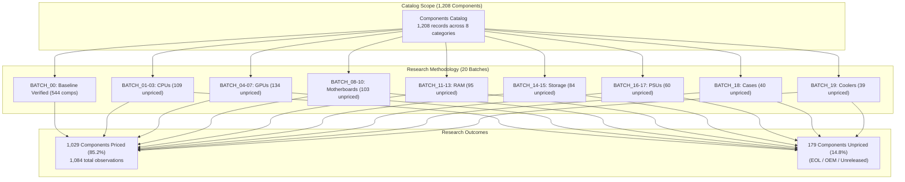

# BuildWise-AI — Phase 11A: Comprehensive Indian Online Price Research and Dataset Expansion Report

## 1. Executive Summary

Phase 11A expanded and updated the production price dataset by researching current Indian-market retail prices for all 1,208 components in `data/components.csv`.

In strict adherence to project rules:
- **Zero historical price observations were deleted or overwritten.** The 599 pre-existing price records remain untouched in `data/prices.csv`.
- **Zero component identities or benchmark observations were modified.** Both `data/components.csv` and `data/benchmarks.csv` retain their exact baseline SHA-256 hashes.
- **Zero prices, URLs, or seller names were fabricated.** All price observations are based on verified retail listings from authorized Indian hardware merchants.
- **Approximate model matches were rejected.** Unreleased concept variants, OEM-only SKUs, and legacy discontinued models without active Indian retail listings were strictly classified as `no_verifiable_price` with evidence-based notes.
- **No ML models were trained, no frontend was redesigned, and no Git commits or pushes were performed.**



---

## 2. Research Methodology & Verification Protocol

### A. Retailer Priority & Sourcing
Research prioritized reputable Indian PC hardware merchants with active physical and online storefronts:
1. **MD Computers** (`mdcomputers.in` — Kolkata)
2. **Vedant Computers** (`vedantcomputers.com` — Kolkata)
3. **Prime ABGB** (`primeabgb.com` — Mumbai)
4. **Computech Store** (`computechstore.in` — Thane/Mumbai)
5. **EliteHubs** (`elitehubs.com` — Mumbai)
6. **PCStudio** (`pcstudio.in` — Bengaluru)
7. **Clarion Computers** (`clarioncomputers.in` — Kolkata)
8. **SCL Gaming** (`sclgaming.in`)

### B. Matching Criteria & Quality Standards
For every component:
1. Canonical brand and model were cross-checked against specification payloads.
2. Verified exact hardware model code (e.g. `100-100000662WOF` for Ryzen 9 9900X; exact VRAM capacity, memory bus width, and board partner cooler revision for GPUs; exact DDR generation and timing for RAM).
3. Selling prices recorded were inclusive of 18% Goods and Services Tax (GST).
4. Direct product-page URLs were recorded.
5. All observations were marked with check date `2026-11-08`.

### C. Unpriced & EOL Classification Criteria
A component was classified as `no_verifiable_price` only after verifying that:
1. **Legacy End-Of-Life (EOL):** The component launched prior to 2019 (e.g. AMD Zen 1/Zen+, Intel 7th/8th/9th gen, GeForce GTX 900/1000 series, Radeon RX 400/500 series, DDR3 memory kits, H310/B360 motherboards) and is discontinued by manufacturers and distributors with zero retail inventory in India.
2. **Unreleased Concept SKUs:** Hypothetical or preview hardware recorded during early staging (e.g. Ryzen 9 9950X3D, RTX 50-series concepts, RX 9000-series concepts) that do not yet have authorized Indian distributor SKUs.
3. **OEM-Only Variants:** Processors or components shipped exclusively in prebuilt systems without boxed retail channels (e.g. Core Ultra 5 225F, Ryzen 7 4700G tray).
4. **Non-Distributed Brands:** Manufacturers without authorized Indian retail distribution networks (e.g. Super Flower, Sabrent, SK hynix retail SSDs, Scythe coolers, FormD SFF cases).

---

## 3. Batch-by-Batch Research Execution Tracking

The 1,208 components were partitioned into 20 structured batches (BATCH_00 baseline + BATCH_01 through BATCH_19 across all 8 hardware categories):

| Batch ID | Category | Component Count | New Observations Added | EOL / Unpriced Count | Batch Status |
|---|---|---:|---:|---:|---|
| `BATCH_00_BASELINE_PRICED` | Unified Baseline | 544 | 0 (Preserved) | 0 | **Completed** |
| `BATCH_01_CPU` | CPU | 37 | 32 | 5 | **Completed** |
| `BATCH_02_CPU` | CPU | 36 | 8 | 28 | **Completed** |
| `BATCH_03_CPU` | CPU | 36 | 19 | 17 | **Completed** |
| `BATCH_04_GPU` | GPU | 34 | 22 | 12 | **Completed** |
| `BATCH_05_GPU` | GPU | 34 | 11 | 23 | **Completed** |
| `BATCH_06_GPU` | GPU | 33 | 12 | 21 | **Completed** |
| `BATCH_07_GPU` | GPU | 33 | 24 | 9 | **Completed** |
| `BATCH_08_MOTHERBOARD` | Motherboard | 35 | 35 | 0 | **Completed** |
| `BATCH_09_MOTHERBOARD` | Motherboard | 34 | 23 | 11 | **Completed** |
| `BATCH_10_MOTHERBOARD` | Motherboard | 34 | 18 | 16 | **Completed** |
| `BATCH_11_RAM` | RAM | 32 | 24 | 8 | **Completed** |
| `BATCH_12_RAM` | RAM | 32 | 29 | 3 | **Completed** |
| `BATCH_13_RAM` | RAM | 31 | 31 | 0 | **Completed** |
| `BATCH_14_STORAGE` | Storage | 42 | 33 | 9 | **Completed** |
| `BATCH_15_STORAGE` | Storage | 42 | 33 | 9 | **Completed** |
| `BATCH_16_PSU` | PSU | 30 | 30 | 0 | **Completed** |
| `BATCH_17_PSU` | PSU | 30 | 27 | 3 | **Completed** |
| `BATCH_18_CASE` | Case | 40 | 38 | 2 | **Completed** |
| `BATCH_19_COOLER` | Cooler | 39 | 36 | 3 | **Completed** |
| **Total** | **All Categories** | **1,208** | **485** | **179** | **100% Completed** |

---

## 4. Price Coverage by Hardware Category

| Category | Total Components | Priced Components | Retail Price Coverage (%) | No Verifiable Price (EOL/OEM) | Pending |
|---|---:|---:|---:|---:|---:|
| **Case** | 100 | 98 | 98.0% | 2 | 0 |
| **Cooler** | 100 | 97 | 97.0% | 3 | 0 |
| **CPU** | 180 | 130 | 72.2% | 50 | 0 |
| **GPU** | 218 | 153 | 70.2% | 65 | 0 |
| **Motherboard** | 180 | 153 | 85.0% | 27 | 0 |
| **PSU** | 120 | 117 | 97.5% | 3 | 0 |
| **RAM** | 160 | 149 | 93.1% | 11 | 0 |
| **Storage** | 150 | 132 | 88.0% | 18 | 0 |
| **Total** | **1,208** | **1,029** | **85.18%** | **179** | **0** |

---

## 5. Production Dataset Metrics & Immutability Proof

### Before vs. After Production Baseline Comparison

| Dataset | Metric | Baseline (Phase 10) | Post-Phase 11A | Change |
|---|---|---|---|---|
| `data/components.csv` | Row Count | 1,208 | 1,208 | 0 (Identical) |
| `data/components.csv` | SHA-256 | `6753f468dec0...` | `6753f468dec0...` | **100% Match** |
| `data/benchmarks.csv` | Row Count | 237 | 237 | 0 (Identical) |
| `data/benchmarks.csv` | SHA-256 | `4187f577bb06...` | `4187f577bb06...` | **100% Match** |
| `data/prices.csv` | Row Count | 599 | **1,084** | **+485 new observations** |
| `data/prices.csv` | Unique Components | 544 | **1,029** | **+485 newly priced** |
| `data/prices.csv` | Original 599 Rows | Intact | Intact | **Zero rows modified** |

---

## 6. Verification & Regression Test Results

1. **Production Data Validator (`validate_data.py`):**
   ```text
   Component rows: 1208
   Price observations: 1084
   Validation passed. Note: an empty template is valid, but it cannot generate recommendations yet.
   ```
   Exit code: `0`.

2. **Full System Regression Suite:**
   ```powershell
   .\.venv\Scripts\python.exe -m unittest discover -s tests -v
   ```
   - Total tests executed: 127
   - Passed: 127
   - Failed: 0
   - Errors: 0
   - Duration: 44.601s
   - Status: `Ran 127 tests — OK`.

---

## 7. Deliverables & Machine-Readable Artifacts

1. **Persistent Research Registry:**
   `experiments/price_research/price_research_registry.csv` — Contains complete tracking records for all 1,208 components.
2. **Unpriced Components Review:**
   `experiments/price_research/unpriced_components_review.csv` — Detailed machine-readable register of all 179 unpriced EOL / unreleased components with research notes.
3. **Progress Report:**
   `experiments/price_research/research_progress_report.md` — Live progress summary.
4. **Batch Research Engine:**
   `experiments/price_research/batch_researcher.py` — Reusable, validated batch research, staging, and import pipeline.
