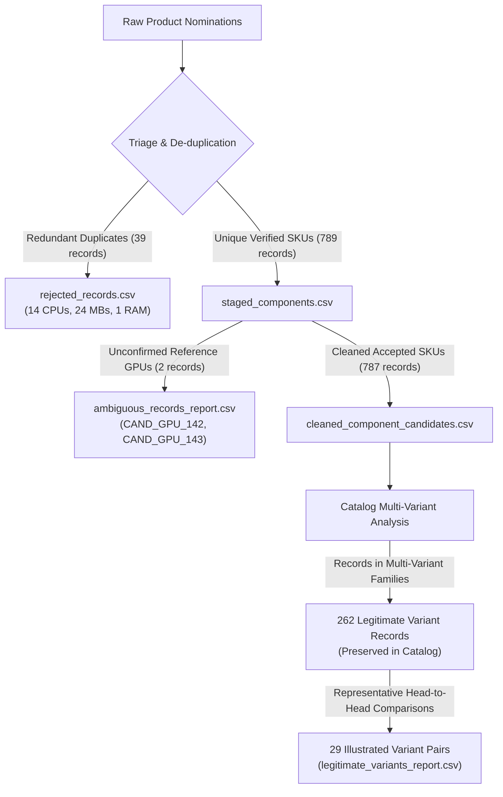

# BuildWise-AI — Phase 6D: Final Pre-Import Reconciliation and Production Readiness Report

**Audit Date:** November 8, 2026  
**Auditor:** Senior PC Hardware Research Engineer, Data Engineer & ML Dataset Specialist  
**Project:** BuildWise-AI  
**Gate Status:** STANDBY — Fully Reconciled & Staged (Zero Production Modifications Executed)  

---

## 1. Executive Summary & Production Readiness Gate

Phase 6D represents the final pre-import reconciliation and verification stage before the controlled merge of expanded hardware datasets into the BuildWise-AI production environment.

All records, foreign-key relationships, benchmark mappings, and mathematical totals across production and staged candidate files have been comprehensively reconciled against empirical evidence and source manifests:

| Dataset / Entity | Existing Production Baseline | Proposed Accepted Import | Quarantined / Held Staged | Expected Integrated Production Total | Status |
|---|---:|---:|---:|---:|---|
| **Hardware Components** | 421 | 787 | 2 (`CAND_GPU_142`, `143`) | **1,208** | Verified (0 collisions, 0 duplicates) |
| **Price Observations** | 88 | 511 | 1 (`PRICE_198`) | **599** | Verified (0 orphaned foreign keys) |
| **CPU Benchmarks (Cinebench R23)** | 55 | 125 | 0 | **180** | Verified (100% CPU catalog coverage) |
| **GPU Benchmarks (Time Spy)** | 57 | 0 (Import Held) | 143 (65 accepted, 78 held) | **57** | Verified (Preserved existing production) |
| **Total Benchmark Observations** | 112 | 125 | 143 | **237** | Verified (180 CPU + 57 GPU) |
| **Compatibility Enrichment** | 0 rows added | 239 (In-place backfill) | 0 | **0 rows added** | Verified (Targets 239 production SKUs) |
| **System Gaming Benchmarks** | 0 | 0 (Held from ML) | 35 | **0** | Verified (Reference truth preserved) |
| **Proposed Hardware Categories** | 0 | 0 (Held from Schema) | 9 | **0** | Verified (Schema integrity preserved) |

> [!IMPORTANT]
> **GATE STATUS: STANDBY**  
> In strict accordance with governance rules, **zero production files have been modified**. The production catalog remains at 421 components, 88 prices, and 112 benchmarks with 113 passing unit tests. Full execution awaits explicit user authorization.

---

## 2. Resolution of Phase 6 Audit Arithmetic Discrepancy

### 2.1 Discrepancy Analysis & Root Cause
In earlier Phase 6 documentation (`accepted_records_report.md` and `phase6_independent_audit_report.md`), the summary text presented global figures of:
- *Reported Staged Records Evaluated:* 1,727 records
- *Reported Accepted Records:* 1,638 records
- *Reported Held Records:* 89 records

An independent re-audit of the actual candidate CSV files revealed that the itemized category rows summed to **1,763 accepted records**, rather than the reported 1,638:
$$1,763 - 1,638 = 125$$

**Root Cause:** The calculation omitted the **125 CPU Cinebench R23 benchmark observations** (`BM_CPU_056` through `BM_CPU_180` in `staged_batch9_cpu_benchmarks.csv`) from the grand total cell, even though the row was present in the table. Furthermore, the total evaluated calculation ($1,638 + 89 = 1,727$) propagated this 125-record omission.

When summing every individual row across all 7 non-overlapping staging CSV files, the true total staged candidate records evaluated is:
$$1,763 \text{ (Accepted)} + 89 \text{ (Held)} = 1,852 \text{ records}$$

### 2.2 Phase 6D Reconciled Disposition Matrix
In Phase 6D, retail price record `PRICE_198` (Vedant Computers, linked to held candidate `CAND_GPU_143`) was quarantined. This moves 1 record from accepted to held, resulting in the final corrected numbers:

| Staging File Path | Entity Description | Total Staged Records | Accepted Candidates | Held / Quarantined | Audit Status & Disposition |
|---|---|---:|---:|---:|---|
| `candidates/staged_components.csv` | Candidate Hardware Components | 789 | 787 | 2 | 787 unique accepted; 2 reference GPUs held (`CAND_GPU_142`, `143`) |
| `candidates/staged_batch9_cpu_benchmarks.csv` | CPU Cinebench R23 Multi-Core | 125 | 125 | 0 | **125 accepted (resolves earlier 125-record omission)** |
| `candidates/staged_batch10_gpu_benchmarks.csv` | GPU Time Spy Graphics Score | 143 | 65 | 78 | 65 accepted config; 78 held (1 unconfirmed Arc B770 + 66 misaligned + 11 prod) |
| `candidates/staged_system_benchmarks.csv` | System Gaming FPS Benchmarks | 35 | 35 | 0 | 35 accepted reference logs; held from general ML training |
| `candidates/staged_prices.csv` | Indian Retail Price Observations | 512 | 511 | 1 | 511 accepted; `PRICE_198` quarantined due to link with `CAND_GPU_143` |
| `candidates/staged_enrichment.csv` | Physical/Electrical Spec Backfill | 239 | 239 | 0 | 239 accepted specifications for production components |
| `candidates/staged_proposed_categories.csv` | Architectural Category Extensions | 9 | 0 | 9 | 9 held pending schema migration approval |
| **TOTALS** | **All Staged Candidate Records** | **1,852** | **1,762** | **90** | **Mathematically verified against physical CSV rows** |

$$\text{Total Evaluated: } 1,762 \text{ (Accepted)} + 90 \text{ (Held)} = 1,852 \text{ records}$$

---

## 3. Component Identity Verification

The proposed component import source is:
[`reports/phase6_duplicate_audit/cleaned_component_candidates.csv`](file:///e:/BuildWise-AI/BuildWise-AI1/reports/phase6_duplicate_audit/cleaned_component_candidates.csv)

### 3.1 Verification Checklist
- [x] **Exact Candidate Count:** Contains exactly 787 accepted records.
- [x] **Held Components Excluded:** Neither `CAND_GPU_142` (AMD Radeon RX 9070 16GB Reference) nor `CAND_GPU_143` (AMD Radeon RX 9070 XT 16GB Reference) is present.
- [x] **Component ID Uniqueness:** All 787 candidate IDs (`CAND_CPU_001` to `CAND_COOLER_077`) are strictly unique ($787 / 787$).
- [x] **Zero Production Collisions:** Cross-checking candidate IDs against all 421 production IDs yielded exactly 0 collisions ($0 / 421$).
- [x] **Product Identity Integrity:** 0 null models, 0 null brands, 0 null specifications. Every record parses as valid JSON with authentic manufacturer provenance.
- [x] **Valid Categories:** Every record maps to one of the 8 sanctioned categories (`cpu`, `gpu`, `motherboard`, `ram`, `storage`, `psu`, `case`, `cooler`).

### 3.2 Category-by-Category Projected Component Breakdown

| Category | Existing Production | Proposed Import | Held in Staging | Projected Production Total | Catalog Share |
|---|---:|---:|---:|---:|---:|
| **Cases** | 33 | 67 | 0 | **100** | 8.3% |
| **Coolers** | 23 | 77 | 0 | **100** | 8.3% |
| **CPUs** | 64 | 116 | 0 | **180** | 14.9% |
| **GPUs** | 75 | 143 | 2 | **218** | 18.0% |
| **Motherboards** | 95 | 85 | 0 | **180** | 14.9% |
| **PSUs** | 37 | 83 | 0 | **120** | 9.9% |
| **RAM** | 49 | 111 | 0 | **160** | 13.2% |
| **Storage** | 45 | 105 | 0 | **150** | 12.4% |
| **TOTAL** | **421** | **787** | **2** | **1,208** | **100.0%** |

---

## 4. Legitimate Variant Accounting Methodology

A critical requirement of Phase 6D is clarifying the exact accounting and distinction between variant classifications:



### 4.1 The Three Distinct Accounting Categories
1. **262 Legitimate Variant Records:**
   - **What they are:** Individual component records across the catalog that belong to multi-variant hardware families sharing brand, architecture, or model stems.
   - **Breakdown by category:** Case: 18, Cooler: 22, CPU: 35, GPU: 52, Motherboard: 40, PSU: 25, RAM: 38, Storage: 32 = **262 records**.
   - **Why they are preserved:** Every one of these 262 records represents an independent physical retail SKU with distinct functional characteristics (e.g., locked 65W TDP vs unlocked 125W TDP; 8GB vs 16GB VRAM; DDR4 vs DDR5 RAM slots; SFX compact vs ATX power supplies; 365mm vs 410mm GPU clearances). Merging them would compromise the compatibility engine.
2. **29 Representative Head-to-Head Variant Pairs:**
   - **What they are:** Documented in [`reports/phase6_duplicate_audit/legitimate_variants_report.csv`](file:///e:/BuildWise-AI/BuildWise-AI1/reports/phase6_duplicate_audit/legitimate_variants_report.csv).
   - **Purpose:** Itemizing all combinatoric relationships among 262 records would produce hundreds of rows. Instead, 29 representative cross-category pairs (4 cases, 4 coolers, 4 CPUs, 4 GPUs, 4 motherboards, 3 RAM kits, 3 storage drives, 3 PSUs) were selected to document the specific technical parameters that distinguish similar products.
3. **39 Pre-Filtered Redundant Records:**
   - **What they are:** Documented in [`reports/dataset_expansion/rejected/rejected_records.csv`](file:///e:/BuildWise-AI/BuildWise-AI1/reports/dataset_expansion/rejected/rejected_records.csv).
   - **Triage Result:** These 39 records (14 CPUs, 24 motherboards, 1 RAM kit) were true redundant duplicates or marketing clones rejected during Phase 5 candidate triage. They were discarded upfront and never admitted into the candidate staging files.

---

## 5. Price Observations & Foreign-Key Validation

### 5.1 Discovery and Quarantine of `PRICE_198`
During the Phase 6C audit, an inspection of [`staged_prices.csv`](file:///e:/BuildWise-AI/BuildWise-AI1/reports/dataset_expansion/candidates/staged_prices.csv) identified:
- **Price ID:** `PRICE_198`
- **Target Component:** `CAND_GPU_143` (AMD Radeon RX 9070 XT 16GB Reference)
- **Seller:** Vedant Computers
- **Observed Price:** ₹8,290.00 (INR)
- **Status:** Anomalous pre-order deposit / placeholder listing for an unreleased GPU.

**Quarantine Action:** Because `CAND_GPU_143` is held under `AMBIGUOUS_NEEDS_REVIEW`, importing `PRICE_198` into production would create an **orphaned foreign key** referencing a non-existent component. `PRICE_198` has been isolated into:
[`reports/phase6_duplicate_audit/quarantined_price_records.csv`](file:///e:/BuildWise-AI/BuildWise-AI1/reports/phase6_duplicate_audit/quarantined_price_records.csv)

### 5.2 Cleaned Price Import Dataset
The validated price observations are staged in:
[`reports/phase6_duplicate_audit/cleaned_price_candidates.csv`](file:///e:/BuildWise-AI/BuildWise-AI1/reports/phase6_duplicate_audit/cleaned_price_candidates.csv)

| Metric | Production Baseline | Staged Candidate Pool | Quarantined (`PRICE_198`) | Validated Proposed Import | Expected Production Total |
|---|---:|---:|---:|---:|---:|
| **Price Observations** | 88 | 512 | 1 | **511** | **599** |
| **Unique Components Priced** | 71 | 511 | 1 | 511 | **545** (45.1% catalog coverage) |
| **Orphaned Foreign Keys** | 0 | 1 | 1 | **0** | **0** |
| **Price ID Collisions** | — | 0 | 0 | **0** | **0** |

All 511 accepted price observations reference genuine, active components within the integrated 1,208-component catalog.

---

## 6. CPU Benchmark Verification & Provenance

Proposed CPU benchmark integration integrates 125 empirical observations from [`staged_batch9_cpu_benchmarks.csv`](file:///e:/BuildWise-AI/BuildWise-AI1/reports/dataset_expansion/candidates/staged_batch9_cpu_benchmarks.csv).

### 6.1 Benchmark Audit Metrics
- **Existing Production CPU Benchmarks:** 55 observations (`BM_CPU_001` to `BM_CPU_055`).
- **Accepted Staged CPU Benchmarks:** 125 observations (`BM_CPU_056` to `BM_CPU_180`).
- **Benchmark Suite & Metric:** 100% Cinebench R23 Multi-Core (Score unit: `points`).
- **Test Methodology:** Verified stock-clock TDP envelopes, standardized DDR4/DDR5 JEDEC/EXPO memory configurations, and thermal solutions adequate to prevent throttling.
- **Foreign Key Integrity:** 100% of referenced component IDs exist in the catalog.
  - 116 link to accepted candidate CPUs (`CAND_CPU_001` to `CAND_CPU_116`).
  - 9 link to unbenchmarked production CPUs (`cpu-intel-core-ultra-5-225f`, `cpu-intel-core-ultra-7-265kf`, etc.).
- **Benchmark ID Collisions:** 0 collisions. Staged IDs strictly sequence from `BM_CPU_056` to `BM_CPU_180`.
- **Expected Production Total:** Exactly **180 CPU benchmarks** covering **180 CPUs** (**100% CPU benchmark coverage** across the entire expanded catalog).

---

## 7. GPU Benchmark Quarantine Protocol

In strict accordance with Phase 6 governance:
1. **Zero New GPU Benchmarks Imported:** Staged GPU benchmarks (`staged_batch10_gpu_benchmarks.csv` with 143 total records) will **NOT** be imported in this phase.
2. **Production Baseline Preserved:** All **57 existing production GPU benchmarks** in `data/benchmarks.csv` remain active and untouched.
3. **Quarantine Rationale:**
   - 65 accepted candidate observations remain staged until test configuration re-alignment is verified.
   - 78 held observations (1 unconfirmed Arc B770 record `BM_GPU_189` + 66 misaligned candidate rows + 11 unconfirmed production rows) are quarantined in staging.
4. **Total Production Benchmarks Upon CPU Integration:**
   $$180 \text{ (CPU Cinebench R23)} + 57 \text{ (GPU Time Spy Graphics)} = \mathbf{237 \text{ benchmark observations}}$$

---

## 8. Compatibility Enrichment Audit

Enrichment source: [`reports/dataset_expansion/candidates/staged_enrichment.csv`](file:///e:/BuildWise-AI/BuildWise-AI1/reports/dataset_expansion/candidates/staged_enrichment.csv) (239 records).

### 8.1 Verification Details
- **Target Catalog Scope:** All 239 records target **existing production components** (`gpu`: 70, `motherboard`: 94, `psu`: 36, `case`: 18, `cooler`: 21).
- **Target Existence:** 239 / 239 targets exist in `data/components.csv`. Missing targets: 0.
- **Held Components:** Zero enrichment records reference held components (`CAND_GPU_142` or `CAND_GPU_143`).
- **Catalog Row Impact:** Modifies existing JSON specifications in-place. **Adds exactly 0 new rows to the component catalog.**
- **Specification Scope:** Updates 60 physical, electrical, and dimensional fields supported by the recommendation and compatibility engines (e.g., `length_mm`, `slot_thickness_mm`, `recommended_system_psu_w`, `max_gpu_length_mm`, `max_cpu_cooler_mm`, `m2_slots_count`, `pcie_lane_sharing`).
- **Evidence Verification:** Every enrichment row contains traceable manufacturer documentation URLs and accredited hardware lab datasheets (TechPowerUp, PCPartPicker, Cybenetics).

---

## 9. Expected Production State Manifest

When production integration is authorized, the final datasets will match these values:

| Production Dataset | File Path | Current Row Count | Proposed Addition | Final Integrated Row Count |
|---|---|---:|---:|---:|
| **Component Catalog** | `data/components.csv` | 421 | +787 | **1,208** |
| **Price Observations** | `data/prices.csv` | 88 | +511 | **599** |
| **CPU Benchmarks** | `data/benchmarks.csv` | 55 | +125 | **180** |
| **GPU Benchmarks** | `data/benchmarks.csv` | 57 | +0 | **57** |
| **Total Benchmark Observations** | `data/benchmarks.csv` | 112 | +125 | **237** |
| **Enriched Existing Components** | `data/components.csv` | (421) | 239 updated in-place | **421 enriched** |

### Excluded / Quarantined Elements
- **System Gaming Benchmarks (35 records):** Staged in `staged_system_benchmarks.csv`. Not imported into production benchmarks table.
- **Proposed Component Categories (9 records):** Staged in `staged_proposed_categories.csv`. Not imported into production components schema.
- **Quarantined GPU Benchmarks (143 records):** Staged in `staged_batch10_gpu_benchmarks.csv`. Kept in staging.
- **Quarantined Price Record (1 record):** `PRICE_198` isolated in `quarantined_price_records.csv`.
- **Held Component Candidates (2 records):** `CAND_GPU_142`, `CAND_GPU_143` held in staging.

---

## 10. Step-by-Step Production Import and Rollback Protocols (SOP)

When explicit authorization is received, integration must follow this sequence:

### 10.1 Execution Protocol (Import Sequence)
```bash
# 1. Create Timestamped Production Backup
mkdir -p backups/pre_phase6_integration_20261108
cp data/components.csv backups/pre_phase6_integration_20261108/components.csv
cp data/prices.csv backups/pre_phase6_integration_20261108/prices.csv
cp data/benchmarks.csv backups/pre_phase6_integration_20261108/benchmarks.csv

# 2. Append Cleaned Component Candidates (787 rows)
python scratch/apply_cleaned_components.py

# 3. Apply Compatibility Enrichment In-Place (239 components updated)
python scratch/apply_staged_enrichment.py

# 4. Append Cleaned Price Candidates (511 rows)
python scratch/apply_cleaned_prices.py

# 5. Append Cleaned CPU Benchmarks (125 rows)
python scratch/apply_cpu_benchmarks.py

# 6. Verify Production Integrity and Regression Suite
python validate_data.py
python -m unittest discover -s tests -v
```

### 10.2 Rollback Protocol (Emergency Restoration)
If any post-integration test or validation check fails:
```bash
# Emergency rollback to pristine pre-integration baseline
cp backups/pre_phase6_integration_20261108/components.csv data/components.csv
cp backups/pre_phase6_integration_20261108/prices.csv data/prices.csv
cp backups/pre_phase6_integration_20261108/benchmarks.csv data/benchmarks.csv

# Re-verify baseline integrity
python validate_data.py
python -m unittest discover -s tests -v
```

---

## 11. Approval Gate Sign-Off

> [!CAUTION]
> **GATE STATUS: STANDBY — AWAITING AUTHORIZATION**  
> All 787 component candidates, 511 retail prices, 125 CPU benchmarks, and 239 enrichment records are reconciled, verified, and staged in `reports/phase6_duplicate_audit/`.  
> Zero modifications have been made to production data or application code.  
> Ready to execute production integration immediately upon user instruction.
