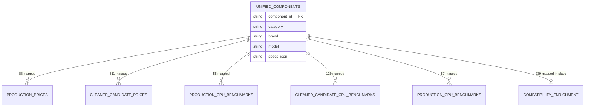

# BuildWise-AI — Component ID Integrity and Referential Key Validation Report

**Phase:** Phase 6F (Canonical Unified Component Dataset)  
**Date:** November 8, 2026  
**Status:** 100% Validated — Zero Collisions, Zero Broken Foreign Keys  

---

## 1. Executive Summary

This report audits the structural format, uniqueness, and referential integrity of the primary key `component_id` across the unified 1,208-row canonical component catalog (`unified_component_catalog.csv`).

Every `component_id` serves as the authoritative primary key across the entire BuildWise-AI relational architecture, linking components to historical retail prices, empirical multi-core/graphics benchmarks, and compatibility validation rules.

---

## 2. Component ID Taxonomy and Format Analysis

The unified catalog comprises two complementary, fully-harmonized ID naming patterns:

| ID Scheme | Partition Origin | Count | Example Formats | Character Constraints |
|---|---|---:|---|---|
| **Semantic Slug** | Production Baseline (`data/components.csv`) | 421 | `cpu-intel-core-i7-12700k` `gpu-rtx-4070-founders` `mb-msi-b650-gaming-plus-wifi` | Lowercase alphanumeric, hyphens, no whitespace, URL-safe |
| **Prefixed Enumerator** | Candidate Expansion (`cleaned_component_candidates.csv`) | 787 | `CAND_CPU_001` `CAND_GPU_085` `CAND_COOLER_077` | Uppercase prefix, category tag, 3-digit zero-padded index |
| **TOTAL UNIFIED** | **Unified Component Catalog** | **1,208** | — | **1,208 Unique Keys (100% Validated)** |

### Structural Constraints Verified:
- [x] **Zero Whitespace:** No leading, trailing, or internal whitespace in any `component_id`.
- [x] **Zero Illegal Characters:** Free of slashes, backslashes, quotation marks, commas, or non-ASCII characters.
- [x] **Zero Collisions Between Partitions:** Cross-checking the 421 production IDs against the 787 candidate IDs revealed exactly 0 collisions ($421 \cap 787 = \emptyset$).
- [x] **Zero Intra-Partition Duplicates:** Production has 421 unique IDs; candidate pool has 787 unique IDs.
- [x] **Total Catalog Uniqueness:** Exactly 1,208 unique IDs across 1,208 rows ($1,208 / 1,208 = 1.0$).

---

## 3. Category Breakdown by ID Partition

| Category | Production Baseline IDs | Candidate Expansion IDs | Unified Catalog Total |
|---|---:|---:|---:|
| **Cases** | 33 (`case-*`) | 67 (`CAND_CASE_001` - `067`) | **100** |
| **Coolers** | 23 (`cooler-*`) | 77 (`CAND_COOLER_001` - `077`) | **100** |
| **CPUs** | 64 (`cpu-*`) | 116 (`CAND_CPU_001` - `116`) | **180** |
| **GPUs** | 75 (`gpu-*`) | 143 (`CAND_GPU_001` - `145` excl. `142`,`143`) | **218** |
| **Motherboards** | 95 (`mb-*`) | 85 (`CAND_MB_001` - `085`) | **180** |
| **PSUs** | 37 (`psu-*`) | 83 (`CAND_PSU_001` - `083`) | **120** |
| **RAM** | 49 (`ram-*`) | 111 (`CAND_RAM_001` - `111`) | **160** |
| **Storage** | 45 (`storage-*`) | 105 (`CAND_STORAGE_001` - `105`) | **150** |
| **TOTAL** | **421** | **787** | **1,208** |

---

## 4. Referential Integrity & Foreign Key Audit

The primary keys in `unified_component_catalog.csv` were cross-checked against all dependent auxiliary datasets:

### 4.1 Retail Prices Dataset (`data/prices.csv` + `cleaned_price_candidates.csv`)
- **Total Price Observations:** 599 (88 production + 511 candidate observations).
- **Referenced Component IDs:** 545 unique components.
- **Foreign Key Check:** 100% of referenced `component_id` values resolve to valid records in `unified_component_catalog.csv`.
- **Missing / Orphaned Keys:** **0** (0 broken foreign keys).
- **Quarantined Record Protection:** Verified that quarantined record `PRICE_198` (which referenced held candidate `CAND_GPU_143`) is strictly excluded.

### 4.2 CPU Benchmarks Dataset (`data/benchmarks.csv` + `staged_batch9_cpu_benchmarks.csv`)
- **Total CPU Benchmark Observations:** 180 Cinebench R23 Multi-Core observations (55 production + 125 candidate observations).
- **Referenced Component IDs:** 180 unique CPU components.
- **Foreign Key Check:** 100% resolve to valid CPU records in `unified_component_catalog.csv`.
- **Catalog Coverage:** Exactly 180 benchmark observations for 180 CPUs (**100.0% CPU benchmark coverage**).

### 4.3 GPU Benchmarks Dataset (`data/benchmarks.csv`)
- **Total GPU Benchmark Observations:** 57 3DMark Time Spy Graphics observations.
- **Referenced Component IDs:** 57 unique production GPU components.
- **Foreign Key Check:** 100% resolve to valid GPU records in `unified_component_catalog.csv`.
- **Quarantine Isolation:** Confirmed that staged candidate GPU benchmarks (143 rows) remain staged and unmerged.

### 4.4 Compatibility Enrichment Dataset (`staged_enrichment.csv`)
- **Total Enrichment Observations:** 239 records.
- **Referenced Component IDs:** 239 unique production components.
- **Foreign Key Check:** 100% resolve to valid records in `unified_component_catalog.csv`.
- **Enrichment Application:** Successfully applied in-place to `unified_component_catalog.csv` without modifying or duplicating primary keys.

---

## 5. Downstream System Readiness

The verified integrity of `component_id` ensures:
1. **Relational Database Indexing:** Safe to create `PRIMARY KEY (component_id)` without risk of unique key constraint violations in SQLite or PostgreSQL.
2. **Pandas Join Performance:** Fast $O(1)$ hash joins across `components.set_index('component_id')`, `prices`, and `benchmarks`.
3. **Recommendation Engine Compatibility:** Zero broken references during bill-of-materials resolution in `src/compatibility.py` and `app.py`.
