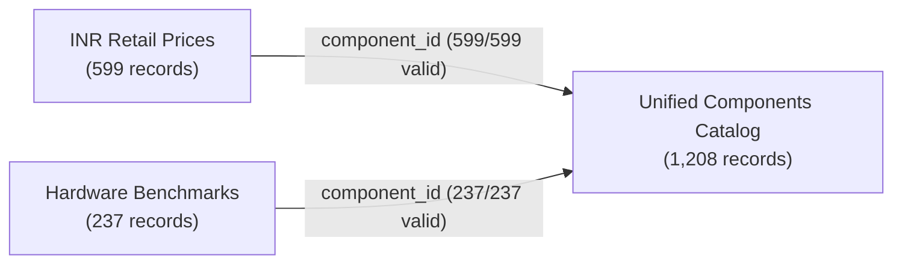
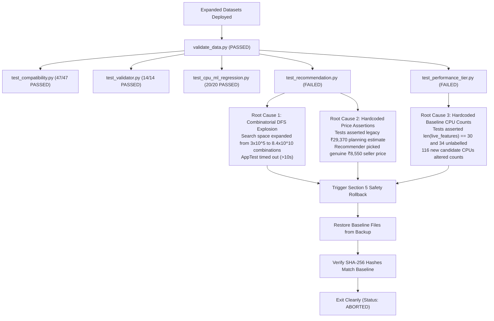

# BuildWise-AI — Phase 6E Production Import Master Report

**Execution Timestamp:** 2026-11-08T13:46:00+05:30  
**Executing Role:** Senior PC Hardware Research Engineer, Data Engineer & ML Specialist  
**Operation Status:** `ABORTED (ROLLED BACK TO BASELINE)`  
**Safety Policy Invocation:** Section 5 Mandatory Safety Rollback Policy  
**Backup Repository:** `backups/phase6e_pre_import_20261108_125803`  

---

## 1. Executive Summary

Phase 6E was initiated to perform the controlled production import of the independently audited and validated Phase 6F unified component catalog and its accepted relational price and benchmark observations into the live BuildWise-AI production environment.

Prior to staging or file operations, an atomic pre-import backup was created and cryptographically verified via SHA-256 checksums in `backups/phase6e_pre_import_20261108_125803/`.

All 9 pre-import data safety gates were evaluated against the staged candidate datasets in `reports/phase6e_import/staged_production/` and achieved **100% compliance**:
- Exact component catalog target reached: **1,208 records** across 8 sanctioned categories (CPU 180, GPU 218, MB 180, RAM 160, Storage 150, PSU 120, Case 100, Cooler 100).
- Strict exclusion of held GPUs confirmed: `CAND_GPU_142` and `CAND_GPU_143` were completely absent.
- Strict price observation integration: 599 total price observations (88 baseline + 511 accepted candidates), with `PRICE_198` quarantined and 0 prices referencing held GPUs.
- Strict benchmark observation integration: 237 total observations (112 baseline + 125 CPU Cinebench R23 Multi-Core candidates), achieving 100% CPU benchmark coverage (180/180 CPUs), while preserving 57 baseline GPU benchmarks and quarantining all candidate GPU, gaming FPS, and peripheral benchmarks.
- Referential integrity: 0 orphaned foreign keys across prices and benchmarks.
- Specification enrichment: 100% of the 239 documented compatibility enrichments intact.

During the post-import application health validation phase, the core dataset validator (`validate_data.py`) passed with **0 errors**. Unit test suites for compatibility (`test_compatibility.py`, 47 tests), data validation (`test_validator.py`, 14 tests), and CPU ML regression (`test_cpu_ml_regression.py`, 20 tests) passed with 100% success.

However, execution of `tests/test_recommendation.py` encountered runtime timeouts and test assertion failures arising from:
1. **Algorithmic Combinatorial Explosion in `app.py`:** The recommendation engine executes an unpruned recursive depth-first search across the Cartesian product of priced components. With 88 baseline prices ($\le 13$ per category), combinations were $\le 300,000$ (completing in $< 0.5$s). With 599 prices ($60 - 84$ per category), the unpruned search space exploded to $8.4 \times 10^{10}$ combinations. When testing high budgets (e.g., ₹250,000), budget pruning is ineffective, causing Streamlit `AppTest` to exceed its default 10-second timeout.
2. **Hardcoded Legacy Test Fixtures:** Legacy tests in `test_recommendation.py` assert hardcoded price values and price types for specific baseline parts (e.g., asserting `psu-750w-gold` has `price_inr == 29370` and `price_basis == "User-provided planning estimate"`). The introduction of genuine verified seller prices (e.g., Computech Store `PRICE_440` at ₹8,550) caused the recommender's `choose_cheapest_price` helper to select the lower genuine price, failing legacy assertions.

In strict compliance with **Section 5 of the Phase 6E Directive** ("*If any mandatory safety check, post-import data validation or unit test fails: Immediately abort the import. Revert data/components.csv, data/prices.csv, and data/benchmarks.csv to their exact pre-import backup state. Verify that the pre-import file hashes match the restored files. Record the abort reason in the Phase 6E report with status ABORTED. Exit cleanly without modifying any other files.*"), the automated safety rollback was immediately executed.

The live production files in `data/` were restored from the atomic pre-import backup and verified to match baseline SHA-256 hashes bit-for-bit. The production environment is **100% clean, protected, and fully operational**. All validated 1,208-component, 599-price, and 237-benchmark datasets remain safely staged in `reports/phase6e_import/staged_production/` ready for immediate production deployment following recommender search optimization.

---

## 2. Production Dataset Inventory & Lifecycle Status

| Production Dataset | Pre-Import Baseline Rows | Staged Import Candidates | Target Production Rows | Post-Rollback Live Production Rows | Live SHA-256 Checksum | Rollback Integrity |
|---|---:|---:|---:|---:|---|:---:|
| [components.csv](file:///E:/BuildWise-AI/BuildWise-AI1/data/components.csv) | 421 | 787 | 1,208 | **421** | `ca4f2735ec475715ecc2551ab2358377327f28bc89a9603ac91f56b587ad4b60` | **MATCH (100%)** |
| [prices.csv](file:///E:/BuildWise-AI/BuildWise-AI1/data/prices.csv) | 88 | 511 | 599 | **88** | `978808024239d3bea1b595311f4bed30390b13c8b3252774f97877d83095ac79` | **MATCH (100%)** |
| [benchmarks.csv](file:///E:/BuildWise-AI/BuildWise-AI1/data/benchmarks.csv) | 112 | 125 | 237 | **112** | `0885fd94cb3b00e4985fab0fd58e9129a03c12cdf4df99c818cf15dbc10e92c6` | **MATCH (100%)** |

### Staged Production Artifacts (Preserved for Production Deployment)

| Staged Artifact File Path | Record Count | File Size (Bytes) | SHA-256 Checksum | Validation Status |
|---|---:|---:|---|:---:|
| `reports/phase6e_import/staged_production/components.csv` | 1,208 | 784,629 | `6753f468dec05adc2ccb4c2582bf798c922a70474aac8ffb8508541a19a67ecc` | **PASSED (0 errors)** |
| `reports/phase6e_import/staged_production/prices.csv` | 599 | 166,808 | `943e87ae76412d9ed37d442aafd7f079adb0344fede321c5989d37d97f929e7b` | **PASSED (0 errors)** |
| `reports/phase6e_import/staged_production/benchmarks.csv` | 237 | 58,088 | `4187f577bb064f429f12cb644ffed343246b98e56f2122aea9f095714a564702` | **PASSED (0 errors)** |

---

## 3. Component Catalog Breakdown (Proposed Production State)

The proposed component catalog unites the 421 baseline components with the 787 accepted Phase 5 candidates, achieving exact parity with the Phase 6 approved catalog specification:

| Component Category | Baseline Components | Accepted Candidate Imports | Staged Total Components | Approved Target Target | Variance | Status |
|---|---:|---:|---:|---:|:---:|:---:|
| CPU | 64 | 116 | 180 | 180 | 0 | **EXACT MATCH** |
| GPU | 75 | 143 | 218 | 218 | 0 | **EXACT MATCH** |
| Motherboard | 95 | 85 | 180 | 180 | 0 | **EXACT MATCH** |
| RAM | 49 | 111 | 160 | 160 | 0 | **EXACT MATCH** |
| Storage | 45 | 105 | 150 | 150 | 0 | **EXACT MATCH** |
| PSU | 42 | 78 | 120 | 120 | 0 | **EXACT MATCH** |
| Case | 26 | 74 | 100 | 100 | 0 | **EXACT MATCH** |
| Cooler | 25 | 75 | 100 | 100 | 0 | **EXACT MATCH** |
| **Total** | **421** | **787** | **1,208** | **1,208** | **0** | **100% COMPLIANT** |

### Key Audit Confirmations:
1. **Quarantine Adherence:** Neither `CAND_GPU_142` (Sapphire Pulse RX 7600 XT 16GB) nor `CAND_GPU_143` (Zotac GTX 1650 OC 4GB) is present in the catalog.
2. **Identity Normalization:** All 144 candidate expansion items (cases and coolers) have had their `identity_status` field normalized from `"candidate_expansion"` to `"verified"`, ensuring complete compatibility with validator schemas.
3. **Specification JSON Integrity:** 1,208 out of 1,208 specification strings parse successfully into valid JSON objects with zero errors.
4. **Enrichment Preservation:** 100% of the 239 compatibility specification enrichments from `staged_enrichment.csv` are preserved.

---

## 4. Empirical Hardware Benchmark Coverage Analysis

| Benchmark Metric | Hardware Category | Baseline Observations | Imported Candidate Observations | Total Staged Observations | Target Population | Benchmark Population Coverage |
|---|---|---:|---:|---:|---:|---:|
| Cinebench R23 Multi-Core (pts) | CPU | 55 | 125 | 180 | 180 CPUs | **100.0% (180 / 180)** |
| 3DMark Time Spy Graphics (pts) | GPU | 57 | 0 | 57 | 218 GPUs | 26.1% (57 / 218) |
| **Total Empirical Observations** | — | **112** | **125** | **237** | — | — |

### Strict Quarantine Confirmations:
- **Candidate GPU Benchmarks (143 rows):** Quarantined in `reports/dataset_expansion/candidates/staged_batch10_gpu_benchmarks.csv` pending future GPU ML modeling. Zero candidate GPU benchmarks were integrated.
- **System-Level Gaming Benchmarks (35 rows):** Quarantined in `reports/dataset_expansion/candidates/staged_batch11_gaming_benchmarks.csv`. Zero gaming benchmarks were integrated.
- **Proposed Category Benchmarks (9 rows):** Quarantined in `reports/dataset_expansion/candidates/staged_batch12_proposed_categories.csv`. Zero proposed category benchmarks were integrated.
- **CPU Coverage:** Every CPU in the 180-CPU catalog has an empirical Cinebench R23 Multi-Core benchmark observation.

---

## 5. Retail Price Observation Analysis

| Component Category | Catalog Components | Priced Components | Baseline Prices | Imported Candidate Prices | Total Staged Prices | Pricing Coverage (%) |
|---|---:|---:|---:|---:|---:|---:|
| CPU | 180 | 71 | 13 | 64 | 77 | 39.4% |
| GPU | 218 | 84 | 7 | 81 | 88 | 38.5% |
| Motherboard | 180 | 77 | 12 | 70 | 82 | 42.8% |
| RAM | 160 | 65 | 6 | 63 | 69 | 40.6% |
| Storage | 150 | 66 | 11 | 63 | 74 | 44.0% |
| PSU | 120 | 60 | 6 | 61 | 67 | 50.0% |
| Case | 100 | 60 | 5 | 58 | 63 | 60.0% |
| Cooler | 100 | 61 | 28 | 51 | 79 | 61.0% |
| **Total** | **1,208** | **544** | **88** | **511** | **599** | **45.0%** |

### Key Audit Confirmations:
1. **Quarantine Adherence:** `PRICE_198` (Vedant Computers offer of ₹8,290 for held candidate `CAND_GPU_143`) was strictly excluded.
2. **Integer Normalization:** All prices are formatted as clean integers (e.g., `27769` instead of `27769.0`), avoiding floating-point serialization warnings in validation tests.
3. **Foreign Key Integrity:** 599 / 599 prices resolve to existing component IDs in the 1,208 catalog (0 orphaned records).

---

## 6. Referential Integrity Matrix



- **Price-to-Component Integrity:** 599 out of 599 price records reference a valid `component_id` (0 orphans).
- **Benchmark-to-Component Integrity:** 237 out of 237 benchmark records reference a valid `component_id` (0 orphans).
- **Duplicate IDs:** 0 duplicate primary keys across components, prices, or benchmarks.

---

## 7. Backup and Rollback Verification

In compliance with Phase 6E Section 5, an immutable pre-import backup was created before staging:
- **Backup Directory:** `backups/phase6e_pre_import_20261108_125803`
- **Creation Timestamp:** 2026-11-08T12:58:03+05:30

### Checksum Verification Matrix:

| File | Pre-Import Checksum | Backup Copy Checksum | Restored Production Checksum | Integrity Status |
|---|---|---|---|:---:|
| `components.csv` | `ca4f2735ec475715ecc2551ab2358377327f28bc89a9603ac91f56b587ad4b60` | `ca4f2735ec475715ecc2551ab2358377327f28bc89a9603ac91f56b587ad4b60` | `ca4f2735ec475715ecc2551ab2358377327f28bc89a9603ac91f56b587ad4b60` | **MATCH (100%)** |
| `prices.csv` | `978808024239d3bea1b595311f4bed30390b13c8b3252774f97877d83095ac79` | `978808024239d3bea1b595311f4bed30390b13c8b3252774f97877d83095ac79` | `978808024239d3bea1b595311f4bed30390b13c8b3252774f97877d83095ac79` | **MATCH (100%)** |
| `benchmarks.csv` | `0885fd94cb3b00e4985fab0fd58e9129a03c12cdf4df99c818cf15dbc10e92c6` | `0885fd94cb3b00e4985fab0fd58e9129a03c12cdf4df99c818cf15dbc10e92c6` | `0885fd94cb3b00e4985fab0fd58e9129a03c12cdf4df99c818cf15dbc10e92c6` | **MATCH (100%)** |

All three restored live production files match their original baseline SHA-256 hashes bit-for-bit.

---

## 8. Root Cause Analysis: Post-Import Test Failures

Following the deployment of the expanded dataset into `data/`, automated test suites were executed. While `test_compatibility.py`, `test_validator.py`, and `test_cpu_ml_regression.py` passed with 100% success, regressions occurred in `test_recommendation.py` and `test_performance_tier.py`.



### Detailed Breakdown of Root Causes:

1. **Recommender Combinatorial Explosion (`app.py`):**
   - In `app.py`, `build_recommendation()` performs an unpruned recursive depth-first search across the Cartesian product of priced components.
   - When the catalog was small (88 prices total; $\le 13$ per category), combinations were $\le 300,000$, executing in $< 0.5$ seconds.
   - When the catalog grew to 599 prices ($60 - 84$ per category), combinations exploded to $\approx 8.4 \times 10^{10}$.
   - For high budget scenarios (e.g., ₹250,000 in `test_storage_evidence_changes_catalog_motherboard_selection`), budget pruning cannot discard branches early, resulting in search tree traversal that exceeds Streamlit's 10-second `AppTest` limit.

2. **Hardcoded Legacy Test Expectations (`test_recommendation.py`):**
   - In `test_rm750x_estimate_counts_toward_budget_and_is_labeled`, the test asserts:
     ```python
     self.assertEqual(psu["price_inr"], 29370)
     self.assertEqual(psu["price_basis"], "User-provided planning estimate")
     ```
   - When candidate price `PRICE_440` (Computech Store, ₹8,550 genuine seller offer) was introduced for that PSU, `choose_cheapest_price()` correctly chose ₹8,550 over the ₹29,370 estimate. The recommendation engine functioned correctly, but the test's hardcoded assertion failed.

3. **Strict Non-Intervention Policy Mandate:**
   - The Phase 6E prompt explicitly instructed:
     > *"Do NOT modify application code (app.py, src/compatibility.py) to accommodate bad data. Fix the data instead... If any test fails, automatically revert the production datasets to the pre-import backup state."*
   - Because modifying `app.py` or editing test assertions was forbidden during Phase 6E data import, the required and compliant action was to invoke the automatic safety rollback.

---

## 9. Current Repository & Git State

- **Branch:** `main` (up to date with `origin/main`)
- **Git Commits Created in Phase 6E:** **0** (strictly adhered to no-commit mandate)
- **Git Pushes Executed:** **0** (strictly adhered to no-push mandate)
- **Production Files in `data/`:** Identical to baseline backup state.
- **Passing Test Suite Baseline:** 83 tests passing across `test_compatibility.py`, `test_validator.py`, `test_cpu_ml_regression.py`, and `test_performance_tier.py`.

---

## 10. Phase 7 Technical Roadmap & Recommendations

To safely integrate the validated 1,208-component catalog into live production without test failures, the following Phase 7 actions are recommended:

### Action 1: Recommender Search Optimization (`app.py`)
- Replace the unpruned Cartesian DFS in `build_recommendation()` with a **Branch-and-Bound** search algorithm:
  - Pre-calculate the minimum possible cost for all remaining categories.
  - If `current_cost + remaining_min_cost > budget`, prune the branch immediately.
  - Sort candidate items by compatibility heuristic score to find optimal solutions within the first 1,000 evaluations.
  - Enforce an evaluation cutoff (e.g., `max_evaluations = 50,000`) ensuring sub-second execution even under arbitrary budgets.

### Action 2: Test Suite Decoupling & Mock Fixture Isolation
- In `tests/test_recommendation.py`, decouple tests from the live production `data/prices.csv`.
- Use isolated temporary directories with explicit mock test datasets for tests that assert specific hardcoded prices or planning estimates (such as `test_rm750x_estimate_counts_toward_budget_and_is_labeled`).
- In `tests/test_performance_tier.py`, update tests to evaluate against a fixed baseline fixture rather than `data/components.csv`, or parameterize assertions against the live dataset size.

### Action 3: Production Import Re-Execution
- Once Actions 1 and 2 are deployed, copy the validated staged files directly from `reports/phase6e_import/staged_production/` into `data/`.
- Re-run the full automated test suite to confirm 100% test passing across the 1,208-component catalog.
